# 项目交接与维护指南（`xiaohongshu_wx_maa`）

> **交接更新日期**：2026-11-21  
> **关联服务端仓库**：`laike-service`（Java 25 + Spring Boot 4.1 + MySQL + Redis）  
> **说明**：本文档已整合项目架构、手机端核心机制、与 `laike-service` 的联动与数据库查询、完整任务下发与数据拉取接口规范、开发调试与打包签名、日常排障以及新机型适配指南，单文件即可覆盖全部维护所需信息。

---

## 1. 项目定位与整体现状

本项目（核心业务位于 `plugins/wechat`，应用名「**微信视频号助手**」）是基于 **MaaTauriAndroid（Tauri + Rust + Android Kotlin）+ MaaFramework（v5.14.2）+ Android 内嵌 Python 3.13 Agent + Shizuku** 构建的微信视频号移动端自动化采集与互动系统：

- **核心能力**：已完整实现 9 类云端任务（推荐/搜索采集、7 类指定链接互动、消息巡检）、三层无硬编码 ID 控件优先识别、实时流式上报、断网补传与 Release APK 自动签名发布。
- **服务端集成**：通过 `patches/wechat-remote-host.patch` + `plugins/wechat/host/` 与 **`laike-service`** 深度联动（授权绑定、WebSocket 长连接任务下发与事件上报、状态回调、OTA 更新、诊断日志）。

### 端到端系统架构

```mermaid
flowchart LR
    Caller["外部调用方 / 业务中台 / 管理后台"] -->|"HTTP X-API-Key\nPOST /api/v1/external/tasks\nGET /api/v1/external/content-events"| Server["laike-service\n(Java 25 / Spring Boot / MySQL / Redis)"]
    Server -->|"HTTP POST 异步状态回调\n(callbackUrl)"| Caller

    Server <-->|"WSS /ws/telemetry\n15s 心跳 + 任务推送 + 实时事件上报 + ACK"| AndroidSvc["Android 宿主 App\nWechatRemoteService.kt\n(前台服务 / Keystore 加密)"]
    AndroidSvc -->|"HTTPS\n/api/v1/licenses/verify\n/api/v1/client/status\n/api/v1/client/diagnostics"| Server

    AndroidSvc <-->|"JNI (wechat_remote.rs)\n启动/停止/轮询状态"| RustHost["MaaTauriAndroid Rust 宿主\n+ MaaFramework 引擎"]
    AndroidSvc <-->|"本机 NanoHTTPD\n127.0.0.1 Bearer Token\n/upload /progress /result"| PyAgent["Python 3.13 Agent\nplugins/wechat/wechat_channels/collector"]
    RustHost -->|"PI CustomAction\nRemoteWechatTask"| PyAgent

    PyAgent -->|"Shizuku 特权控制\nUiDump 控件树 + 剪贴板直读\n局部/整页 OCR 兜底"| WeChat["手机微信 App\n(com.tencent.mm)"]
```



---

## 2. 仓库目录与核心模块

```text
xiaohongshu_wx_maa/
├── HANDOVER.md                         # 本文档：完整交接、接口规范、数据库查询与维护指南
├── .env.example                        # 命令行直连上报测试用环境变量模板（WECHAT_LICENSE_KEY / WECHAT_DEVICE_ID）
├── .github/workflows/
│   ├── android-release.yml             # 正式 Release APK 自动构建、签名与 GitHub Release 发布
│   └── wechat-tests.yml                # 视频号 Python 业务逻辑单测 CI
├── docs/                               # 历史批次验收、实时上报与耗时分析记录
├── spec/wechat-laike/                  # 视频号接入服务端的需求规范与真机验收清单记录
├── patches/
│   ├── maa-tauri-android.patch         # 通用宿主补丁（延迟 OCR、剪贴板、框架传递、前端交互修复）
│   └── wechat-remote-host.patch        # 视频号专用宿主补丁（接入 WechatRemoteService、首页绑定卡片、构建集成）
├── host/MaaTauriAndroid/               # 固定版本宿主仓库（CI 固定检出 commit 4da508b20e4d7be132621ca24ec32f2b5b5a5fa0）
├── plugins/
│   └── wechat/
│       ├── profile.toml                # APK 打包配置（应用名、Python runtime 路径、数据目录 WECHAT_DATA_DIR）
│       ├── host/
│       │   ├── android/WechatRemoteService.kt  # Android 前台长连接服务、本地桥接、断网补传、自更新、诊断上报
│       │   └── wechat_remote.rs                # Tauri 命令 & JNI 桥接（nativeStart/nativeStatus/nativeStop）
│       ├── tools/
│       │   ├── build-ui-helper.sh              # 编译 ui-dump.dex（控件树、真实截图与剪贴板直读辅助工具）
│       │   ├── dispatch-integration-task.py    # 命令行向 laike-service 下发联调任务并轮询结果
│       │   ├── prepare-build-environment.py    # macOS 一键安装 Android SDK/NDK 构建依赖
│       │   └── verify-*.py                     # 联调数据、平台绑定、请求幂等性验证脚本
│       ├── tests/                              # 插件资源、配置、远程限流等单测
│       └── wechat_channels/
│           ├── interface.json                  # MAA PI v2 入口声明
│           ├── agent/main.py                   # Agent 启动引导，转调 collector/main.py
│           └── collector/                      # ★ 视频号核心业务代码（见下表）
└── tools/debug_console/                        # ★ 本地 Web 可视化调试台（查看运行时间线、控件树、热重载解析器、下发 ADB 调试任务）
```

### `plugins/wechat/wechat_channels/collector/` 核心文件职责

| 文件 | 职责说明 |
| --- | --- |
| `main.py` | MAA CustomAction 注册入口（含云端任务入口 `RemoteWechatTask` 与本地任务入口） |
| `remote_task.py` | 云端任务总调度器：文件锁串行控制、解析 `task`/`options`、通过本机 `RemoteBridge` 回传进度/数据/终态结果、执行 `sync_discovery` 离线补传 |
| `modes.py` | `collect_channels` 推荐/搜索采集主流程：视频过滤、连续 50 条跳过熔断、单视频异常隔离跳过、实时流式上报 |
| `collection.py` | 作品详情抽屉、作者主页、基础信息页采集与本地 `videos.sqlite3` 草稿保存 |
| `comments.py` | 评论抽屉解析与采集：从上到下深度优先逐条采评论、访问评论者资料并展开二级回复；按外层容器类名判别一/二级层级；`RecyclerView` 原生 `ACTION_SCROLL_FORWARD` 触底检测 |
| `links.py` | 7 类指定链接任务执行器（文件传输助手粘贴发送跳作品页、私信发送确认与 3 次自动重发、`link_actions.json` 永久幂等账本） |
| `interactions.py` | 视频号消息中心巡检（`inspect_messages`，含评论点击前目标行 ROI 稳定校验与个人页进入等待防折叠）及每日配额控制（`daily_quotas.json`） |
| `hierarchy.py` | **核心识别引擎**：无硬编码微信混淆 ID 的三层控件优先识别、多层浮层遮挡判定（推荐流 < 评论抽屉 < 资料页/菜单）、容器局部 OCR 与控件纠错 |
| `layout.py` | 通用版面行聚类、日期/地区/文案/元数据解析规则 |
| `accessibility.py` | 任务期间通过 Shell 临时开启 Google 随选朗读（`SelectToSpeakService`）暴露微信控件树，结束后按 `accessibility-owner.json` 恢复原设置 |
| `foreground.py` | 前台微信状态检测与任务启动前自动唤醒屏幕、拉起微信到前台 |
| `frames.py` | Debug 版默认开启 `540px` JPEG 真实截图落盘与按磁盘配额滚动清理，供 Web 调试台可视化还原 |
| `android_ui.py` | 封装 MaaFramework 截图/点击/返回、`UiDump` 控件抓取与剪贴板直读、ROI 稳定等待及执行期前台保护 |
| `publisher.py` | `WechatPublisher` 本地 Outbox 与 ACK 状态机（复用 `videos.sqlite3` 的 `metadata` 表，支持断网保留与重连补传） |
| `upload.py` | 事件字段映射（`author_wechat_channels_id` → `authorWechatChannelsId`、`wechat_channels_id` → `wechatChannelsId`）、`contentHash` 计算及独立命令行 WebSocket 上报 |
| `phone.py` / `run-phone.sh` | 真机免重新打包直接通过 ADB 运行 Python 采集/链接/自检任务的 CLI 入口 |

---

## 3. 核心技术机制（维护必读）

接手维护时，以下 4 个设计机制最容易在改代码或排障时踩坑，请务必先熟悉：

### 3.1 微信控件暴露与「三层无 ID 控件优先」识别架构

1. **为什么需要随选朗读（`accessibility.py`）**：
   微信默认不向 Android 无障碍树输出完整控件，仅在系统启用读屏类无障碍服务时才暴露控件树。每个任务启动时，`expose_controls()` 以 Shell 权限临时开启 Google 无障碍套件中的「随选朗读」（`com.google.android.marvin.talkback/...SelectToSpeakService`，它**不接管触摸手势**），并把手机原本的无障碍配置记录到 `accessibility-owner.json`；任务正常或异常退出时自动恢复。若手机未安装 Google 无障碍套件，则自动降级为整页 OCR。
2. **三层识别策略（`hierarchy.py`）**：
   - **L1 纯控件层**：过滤底部被遮挡的全屏浮层（通过 `SeekBar`、顶部页签、评论抽屉标题等**语义结构**判定层级，不再依赖微信每个版本都会变化的混淆资源 ID）。
   - **L2 局部 OCR 兜底**：仅对微信自绘/无文字的少量区域做裁剪后局部 OCR。
   - **L3 整页 OCR + 控件纠错**：页面校验不通过时退回整页 OCR，并用位置重叠的控件文本修正 OCR 错字。
   - **维护原则**：**严禁重新引入硬编码的微信混淆控件 ID（如 `c6d`、`fzm` 等）**——微信每次小版本升级都会重新混淆 ID（已在 commit `0c04f52` 全面清除），新增页面识别请坚持使用语义文本、控件类名、几何拓扑与相对位置定位。

### 3.2 手机端与宿主之间的通信闭环

1. `WechatRemoteService.kt` 是 Android 前台服务（通知栏常驻），负责：
   - 用 Android Keystore（`SecretBridge`）加密保存服务器地址、软件代码、授权码、Android ID。
   - 每 15 秒通过 WebSocket（`/ws/telemetry`）上报心跳，每 5 分钟轮询 `/api/v1/client/status` 检查 APK 更新与通知。
   - 启动一个仅绑定 `127.0.0.1` 随机端口、带随机 `Bearer Token` 的 `NanoHTTPD` 本机桥接服务（`LocalBridge`）。
2. 当服务端下发 `WECHAT_CHANNELS_TASK` 时：
   - `WechatRemoteService` 通过单线程 `worker` 保证同一台手机严格串行执行。
   - 先调用 `awaitPreparation()` 等待宿主、项目资源、MaaFramework 引擎和 Shizuku 特权控制连接就绪（最长 180 秒）。
   - 通过 JNI（`wechat_remote.rs::nativeStart`）启动 MaaFramework 执行自定义动作 `RemoteWechatTask`，并将本机桥接地址、Token、`commandId`、`scope` 注入 `taskConfig.remote`。
   - Python 侧（`remote_task.py`）执行期间通过本机 HTTP `POST /progress`、`/upload`、`/result` 与 Kotlin 服务通信，**无需在 Python 侧保存或暴露授权码**。

### 3.3 实时流式上报、数据隔离与断网补传

- **多账号/多环境隔离**：手机端所有运行日志、本地 SQLite 数据库、配额与去重账本均按 `scope = sha256(server|softwareCode|licenseKey|machine)` 隔离存放在：
  ```text
  /data/local/tmp/wechat-channels-data/remote/<scope>/
  ├── videos.sqlite3          # 本地 VIDEO/COMMENT/USER 草稿 + metadata 表（待上报队列与已确认 ACK）
  ├── collection.lock         # fcntl 文件锁，防并发执行
  ├── link_actions.json       # 链接互动永久幂等账本（不按天清零）
  ├── daily_quotas.json       # 每日互动配额记录
  └── runs/<runId>/           # 每次运行的 timings.jsonl、控件快照、Debug 540px JPEG 截图、uploads/*-request/ack.json、remote-result.json
  ```
- **Debug 真实截图与滚动清理（`frames.py`）**：Debug 构建默认保存 `540px` 宽 JPEG 真实界面截图以便 Web 调试台复盘，并按磁盘配额自动滚动清理旧运行截图，防止塞满手机存储。
- **实时上报顺序**：采完视频立即发 `VIDEO` → 评论采完并访问完评论者资料返回后立即发 `COMMENT` + `USER`（严格保证 `VIDEO` → `COMMENT` → `USER` 的父子先后顺序）。
- **断网容错**：
  - 数据层：未收到服务端 `discoveryAckIds` 的事件保留在 `videos.sqlite3` 中；WebSocket 重新连接上线后，`WechatRemoteService` 在空闲时自动触发内部任务 `sync_discovery`，将待上传事件全部补传清零。
  - 任务回执层：终态 `command_ack` 先原子写入 `<app filesDir>/wechat-remote/<scope>/<commandId>.receipt.json`，每 15 秒随心跳重发，**直到收到服务端 `command_ack_receipt (ok=true)` 后才删除**；重复收到的已完成 `commandId` 会直接重发 `<commandId>.done.json` 而不重复执行。
  - 崩溃恢复：执行前写入 `<commandId>.active.json`；若 App 强杀重启，下次启动自动将其标记失败并上报回执（`"App 重新启动，原任务已中断"`）。

### 3.4 微信自动拉起、链接跳转与私信发送确认

- **启动自动唤醒拉起微信（`foreground.py` / `android_ui.py`）**：所有任务开始前会自动唤醒屏幕并确认/拉起微信到前台；一旦进入业务执行阶段，若检测到微信被切出前台则立即中止操作防误点。
- **分享链接提取**：采集视频时点击「转发 → 复制链接」，通过 `UiDump` 系统剪贴板直读（无需切屏或粘贴到搜索框）。
- **链接跳转执行**：7 类 `link_*` 任务统一将完整链接写入剪贴板，打开微信「文件传输助手」粘贴，从控件树逐字核对与目标链接完全一致后发送，再点击气泡进入 `FinderShareFeedRelUI`（若未匹配输入框或文字不一致则立即中止，并做了防误入微信「搜一搜」保护）。
- **私信可靠性**：点击发送后等待 3 秒并持续监测发送状态（单次最长 60 秒）；若出现「重发」感叹号控件，自动重新定位最新消息对应按钮并最多重发 3 次；连续两次检查无进度且无失败标记才记入 `link_actions.json`。

---

## 4. 与 `laike-service` 的联动关系与数据库查询

本项目不是独立运行的系统，手机端强依赖 **`laike-service`**（同级仓库目录 `/Users/leftover/Desktop/company-project/laike-service`）完成授权校验、任务调度、数据入库、后台管理与 APK 分发。

### 4.1 服务端技术栈与运行环境

- **技术栈**：Java 25、Spring Boot 4.1、Spring Security、Spring Data JPA / MyBatis-Plus、MySQL、Redis。
- **双环境隔离（重要）**：`laike-service` 未指定 profile 时默认启动 `test`，**正式环境必须显式指定 `prod`**。

| 环境 | Spring Profile | 默认监听端口 | 常用公网 / 网关基址示例 | MySQL 数据库 | Redis 库 | 后台会话 Cookie |
| --- | --- | --- | --- | --- | --- | --- |
| 测试环境 | `test`（默认） | `10096` | 按实际测试域名 / `http://127.0.0.1:10096` | `huoke` | `13` | `LAIKE_TEST_SESSION` |
| 正式环境 | `prod` | `10092` | `https://api.joyfile.net/huoke` | `qiaomen_license` | `15` | `LAIKE_PROD_SESSION` |

### 4.2 服务端核心代码索引（涉及视频号改动时需同步修改）

当你要新增任务类型、调整参数校验、修改事件结构或排查服务端问题时，重点关注以下 `laike-service` 文件：

| 服务端类（`com.qiaomen.license.*`） | 负责内容 |
| --- | --- |
| `service.WechatTaskConfig` | **视频号 9 类任务与参数的唯一校验真相源**（白名单字段、默认值、范围限制、链接合法性校验、历史配置兼容 `storedCollection`） |
| `controller.ExternalApiController` | 外部系统 HTTP 接口入口（`/api/v1/external/tasks`、`/content-events`、`/licenses/online` 等） |
| `service.RemoteCommandService` | `createWechat()` 任务创建、授权与设备强校验、幂等冲突检查、`STOP` 清理 `PENDING` 任务、24 小时超时清理 |
| `service.CommandCallbackService` | 任务状态变更时异步 HTTP POST `callbackUrl` 并记录 `remote_command_callback` |
| `config.TelemetryWebSocketHandler` | `/ws/telemetry` 长连接鉴权、心跳注册、处理 `command_status` / `command_ack`（回发 `command_ack_receipt`）及分发 `discoveryEvents` |
| `service.WechatDiscoveryService` | 校验并批量入库视频号 `VIDEO`/`COMMENT`/`USER` 事件（SHA-256 `contentHash`、父子一致性），并在同事务回填 `COMMENT` 的作者视频号 ID 与写变更流 |
| `controller.AdminWechatTaskController` | 后台「视频号任务」页面（`/admin/wechat/tasks`），展示已保存配置与最近 30 条采集事件 |
| `controller.AdminController` | 后台 `/admin/configs` 与 `/admin/control/command`（保存采集设置与后台手动下发 `START`/`STOP`/`SYNC_CONFIG`） |
| `controller.LicenseApiController` | 手机端登录绑定认证 `POST /api/v1/licenses/verify` |
| `controller.ClientSupportApiController` | 手机端更新检查 `POST /api/v1/client/status`（更新渠道 `WECHAT_CHANNELS`）与诊断提交 `POST /api/v1/client/diagnostics` |

### 4.3 关键数据库表

| 表名 | 用途 |
| --- | --- |
| `license_key` | 授权码信息（视频号需 `platform_type = 'WECHAT_CHANNELS'`、`plan = 'SMART'`） |
| `license_config` | 后台为授权码保存的默认采集配置（`collect_channels` JSON） |
| `remote_command` | 所有下发任务的持久化记录（`command_id`、`external_request_id`、`command_type`、`task_config_json`、`status`、`result_message`、`callback_url`） |
| `remote_command_callback` | 每次外部状态回调的请求体、HTTP 状态码、响应体与耗时 |
| `content_discovery_event` | 采集到的 `VIDEO`、`COMMENT`、`USER` 事件主表（视频号事件 `payload_json.platform = 'wechat'`，默认保留 30 天） |
| `content_discovery_change` | 事件新增（`CREATED`）及字段补全（`COMMENT_AUTHOR`）变更流 |
| `client_release` | 客户端版本发布表（视频号 APK 需发布到 `release_channel = 'WECHAT_CHANNELS'`） |
| `diagnostic_report` | 手机端异常自动上报的诊断日志表 |

### 4.4 数据库常用查询与核对 SQL

连接对应环境的 MySQL 库（测试库 `huoke` / 正式库 `qiaomen_license`）即可直接查询上报数据与任务状态：

```sql
-- 1. 按事件类型统计视频号上报数量与最新时间
SELECT event_type, COUNT(*) AS cnt, MAX(found_at) AS latest_found_at
FROM content_discovery_event
WHERE JSON_UNQUOTE(JSON_EXTRACT(payload_json, '$.platform')) = 'wechat'
  -- AND license_value = '你的授权码'
GROUP BY event_type;

-- 2. 查询最近上报的视频（VIDEO）
SELECT
  id, event_id, license_value, device_id, source_mode,
  JSON_UNQUOTE(JSON_EXTRACT(payload_json, '$.authorNickname'))         AS author_nickname,
  JSON_UNQUOTE(JSON_EXTRACT(payload_json, '$.authorWechatChannelsId')) AS author_channels_id,
  JSON_UNQUOTE(JSON_EXTRACT(payload_json, '$.videoUrl'))               AS video_url,
  JSON_UNQUOTE(JSON_EXTRACT(payload_json, '$.searchKeyword'))          AS search_keyword,
  LEFT(JSON_UNQUOTE(JSON_EXTRACT(payload_json, '$.description')), 60)  AS description_preview,
  found_at, created_at
FROM content_discovery_event
WHERE event_type = 'VIDEO'
  AND JSON_UNQUOTE(JSON_EXTRACT(payload_json, '$.platform')) = 'wechat'
ORDER BY id DESC
LIMIT 30;

-- 3. 查询某个视频下的全部评论及关联评论者资料（VIDEO -> COMMENT -> USER）
SELECT
  c.event_id AS comment_event_id,
  JSON_UNQUOTE(JSON_EXTRACT(c.payload_json, '$.commentLevel'))           AS level,
  JSON_UNQUOTE(JSON_EXTRACT(c.payload_json, '$.nickname'))               AS commenter_nickname,
  JSON_UNQUOTE(JSON_EXTRACT(c.payload_json, '$.content'))                AS comment_content,
  JSON_UNQUOTE(JSON_EXTRACT(c.payload_json, '$.commentTime'))            AS comment_time,
  JSON_UNQUOTE(JSON_EXTRACT(c.payload_json, '$.authorWechatChannelsId')) AS commenter_channels_id,
  u.event_id AS user_event_id,
  JSON_UNQUOTE(JSON_EXTRACT(u.payload_json, '$.profileLocation'))        AS user_location,
  JSON_UNQUOTE(JSON_EXTRACT(u.payload_json, '$.authorBio'))              AS user_bio,
  c.found_at
FROM content_discovery_event c
LEFT JOIN content_discovery_event u
  ON u.parent_event_id = c.event_id AND u.event_type = 'USER'
WHERE c.event_type = 'COMMENT'
  AND c.parent_event_id = '<填入上面查到的 VIDEO event_id>'
ORDER BY c.id ASC;

-- 4. 检查是否存在父事件缺失的“孤儿事件”（正常应返回 0 行）
SELECT e.event_id, e.event_type, e.parent_event_id
FROM content_discovery_event e
LEFT JOIN content_discovery_event p ON p.event_id = e.parent_event_id
WHERE JSON_UNQUOTE(JSON_EXTRACT(e.payload_json, '$.platform')) = 'wechat'
  AND e.parent_event_id IS NOT NULL
  AND p.event_id IS NULL;

-- 5. 查询某授权码最近下发任务的执行状态与结果说明
SELECT command_id, external_request_id, license_value, command_type, status, result_message, created_at, completed_at
FROM remote_command
WHERE license_value = '你的授权码'
ORDER BY id DESC
LIMIT 20;
```

### 4.5 后台操作标准流程（新设备上线）

1. 在 `laike-service` 后台（或通过 `POST /api/v1/external/licenses`）创建 `platformCode = WECHAT_CHANNELS`、`planCode = SMART`（智联版）的授权码。
2. 手机安装「微信视频号助手」APK 与 Shizuku，完成 Shizuku 授权，并将 **App 与 Shizuku 均加入电池优化白名单/允许后台运行**（推荐安装 Google 无障碍套件以启用控件直读）。
3. 打开视频号助手首页「云端服务」卡片，填写服务地址（如 `https://api.joyfile.net/huoke`）、软件代码（默认 `qiaomen`）和授权码，点击连接并等待状态变为「在线」。
4. （可选）在 `laike-service` 后台「视频号任务」（`/admin/wechat/tasks`）选择该设备并保存默认采集参数（保存只更新配置不执行），之后在「设备与下发」或通过外部接口执行 `START` / `SYNC_CONFIG` / `STOP` / `WECHAT_CHANNELS_TASK`。

---

## 5. 任务下发、回调与数据采集完整接口规范（`laike-service`）

本节完整定义外部业务系统 / 中台通过 `laike-service` 调用微信视频号能力的所有接口，并附手机端内部通信协议。下文所有接口路径均相对于服务基址 `BASE_URL`（如 `https://api.joyfile.net/huoke`）。

### 5.1 接入认证、限流与前置条件

- **认证方式**：所有 `/api/v1/external/**` 接口均通过 HTTP 请求头认证：
  ```http
  X-API-Key: <服务端配置的外部 API Key>
  Content-Type: application/json; charset=utf-8
  ```
- **限流策略**：默认按来源 IP 限流 **1000 次 / 分钟**（可通过服务端流量策略覆盖）；超限时返回 HTTP `429 Too Many Requests`：
  ```json
  {
    "success": false,
    "message": "请求过于频繁，请稍后再试",
    "limit": 1000,
    "windowSeconds": 60
  }
  ```
- **认证失败响应**：
  - `503 Service Unavailable`：`{"success": false, "message": "外部任务API尚未配置"}`
  - `401 Unauthorized`：`{"success": false, "message": "API Key无效"}`
- **任务下发前置条件**（对指定 `licenseKey` 下发任务前必须全部满足，否则返回 `400 Bad Request`）：
  1. 授权码存在、状态为 `ACTIVE`、未过期，且所属软件（如 `qiaomen`）处于启用状态。
  2. 授权码平台类型 `platformCode` 必须为 **`WECHAT_CHANNELS`**。
  3. 授权码套餐必须支持云端任务（`planCode = SMART`，即智联版；启航版 `STARTER` 不支持远程任务下发）。
  4. 授权码已在「微信视频号助手」手机端完成登录绑定，且设备已完成至少一次在线认证（`deviceId` 非空且与遥测记录一致）。
  5. 若设备当前在线，客户端上报的能力集必须包含 `WECHAT_CHANNELS_TASK`。

---

### 5.2 授权与设备状态前置接口

#### 5.2.1 创建视频号授权码

- **接口**：`POST /api/v1/external/licenses`
- **响应**：HTTP `201 Created`，返回创建的 `licenses` 列表。

**请求体示例**：
```json
{
  "softwareCode": "qiaomen",
  "planCode": "SMART",
  "platformCode": "WECHAT_CHANNELS",
  "validityDays": 30,
  "count": 1,
  "ownerPhone": "13800138000",
  "requestId": "provision-wechat-001"
}
```

| 字段 | 类型 | 必填 | 说明 |
| --- | --- | --- | --- |
| `softwareCode` | string | 是 | 软件代码，如 `qiaomen`，正则 `[A-Za-z0-9_-]{1,50}` |
| `planCode` | string | 是 | `STARTER`（启航版）或 `SMART`（智联版，支持云端任务） |
| `platformCode` | string | 否 | 默认 `DOUYIN`；视频号必须传 **`WECHAT_CHANNELS`** |
| `validityDays` | int | 是 | 有效天数，`1` ~ `365` |
| `count` | int | 是 | 生成数量，`1` ~ `100` |
| `ownerPhone` | string | 否 | 归属手机号（11 位中国大陆手机号） |
| `requestId` | string | 否 | 幂等请求编号（最长 100 字符）；重复成功使用返回 `409 Conflict` |

#### 5.2.2 查询设备绑定与在线状态

- **接口**：`POST /api/v1/external/licenses/online`
- **用途**：下发任务前检查授权码是否有效、是否绑定设备、手机客户端是否在线及权限是否就绪（`screenCaptureActive: true` 表示 App、资源、MaaFramework 与 Shizuku 均就绪）。

**请求体**：
```json
{
  "licenseKey": "XXXX-XXXX-XXXX-XXXX"
}
```

**响应示例（HTTP `200 OK`）**：
```json
{
  "success": true,
  "licenseKey": "XXXX-XXXX-XXXX-XXXX",
  "valid": true,
  "status": "ACTIVE",
  "softwareCode": "qiaomen",
  "platformCode": "WECHAT_CHANNELS",
  "platformName": "微信视频号",
  "planCode": "SMART",
  "planName": "智联版",
  "bound": true,
  "deviceId": "a1b2c3d4e5f67890",
  "online": true,
  "clients": [
    {
      "clientRole": "OPERATOR",
      "clientApp": "WECHAT_CHANNELS",
      "appName": "视频号助手",
      "clientVersion": "1.0.40"
    }
  ],
  "appVersions": {
    "WECHAT_CHANNELS": "1.0.40"
  },
  "screenCaptureActive": true,
  "lastReportedAt": "2026-11-20T02:15:00Z",
  "checkedAt": "2026-11-20T02:15:05Z"
}
```

#### 5.2.3 查询授权码详情与已保存采集配置

- **接口**：`POST /api/v1/external/license-info`
- **用途**：查询单个（`{"licenseKey": "KEY-1"}`）或批量（`{"licenseKeys": ["KEY-1", "KEY-2"]}`，最多 100 个）授权码的绑定信息、最近 20 条命令及后台已保存的默认采集配置（`taskConfig`、`taskConfigVersion`）。

---

### 5.3 任务下发接口（核心）

- **接口**：`POST /api/v1/external/tasks`
- **成功状态码**：HTTP `202 Accepted`

#### 请求体顶层字段

| 字段 | 类型 | 必填 | 校验规则 / 说明 |
| --- | --- | --- | --- |
| `licenseKey` | string | 是 | 目标设备的授权码（自动去空格转大写，最长 64 字符）。服务端据此确定设备与平台，无需额外传平台字段 |
| `requestId` | string | 是 | 调用方全局唯一请求编号（最长 64 字符），用于幂等去重 |
| `action` | string | 是 | 视频号设备仅支持 4 种动作：`START`、`STOP`、`SYNC_CONFIG`、`WECHAT_CHANNELS_TASK` |
| `taskConfig` | object | 视 `action` 而定 | 任务执行参数对象（序列化后不得超过 **32,000 字节**） |
| `callbackUrl` | string | 否 | 回调接收地址，须为完整 `http://` 或 `https://` URL（最长 512 字符） |

#### `action` 行为说明

| `action` | 映射内部命令类型 | `taskConfig` 要求 | 行为说明 |
| --- | --- | --- | --- |
| `START` | `WECHAT_CHANNELS_TASK` | **可选** | 省略或为空对象 `{}` 时，自动读取后台「视频号任务」页面为该授权码保存的 `collect_channels` 配置快照并下发；若显式传入，则仅接受 `task = "collect_channels"` |
| `SYNC_CONFIG` | `SYNC_CONFIG` | **可选** | 省略时读取后台已保存的 `collect_channels` 配置；显式传入时仅接受 `task = "collect_channels"`。手机端将配置写入本地 `config.json`，**不中断当前执行状态** |
| `STOP` | `STOP_TASK` | **禁止携带**（须省略或为空） | 立即取消服务端该授权码所有 `PENDING` 的视频号任务（置为 `EXPIRED` 并触发回调），并向手机发送停止命令终止当前执行及手机端排队任务 |
| `WECHAT_CHANNELS_TASK` | `WECHAT_CHANNELS_TASK` | **必填** | 下发具体的视频号 9 类业务任务之一（采集、7 类指定链接互动、消息巡检） |

#### `requestId` 幂等与冲突规则

- 相同 `requestId`、相同 `licenseKey`、相同 `deviceId`、相同命令类型、相同校验后 `taskConfig` 及相同 `callbackUrl` 重发：**直接返回原任务对象**（不重复创建、不重复下发）。
- 相同 `requestId` 但修改了设备、授权码、动作、参数或 `callbackUrl`：返回 `400 Bad Request`（`"请求编号已用于其他设备或参数"`）。

#### 成功响应示例（HTTP `202 Accepted`）

```json
{
  "success": true,
  "taskId": "998df775-d9bf-45c7-9434-6664377ac495",
  "requestId": "channels-collect-20261120-001",
  "action": "WECHAT_CHANNELS_TASK",
  "status": "PENDING",
  "deviceId": "a1b2c3d4e5f67890",
  "targetClientRole": "OPERATOR",
  "online": true,
  "resultMessage": null,
  "publishPlatform": null,
  "publishedWorkUrl": null,
  "createdAt": "2026-11-20T02:20:00.123Z",
  "completedAt": null,
  "hasTaskConfig": true,
  "taskConfig": {
    "task": "collect_channels",
    "options": {
      "entry": "search",
      "keyword": "家常菜",
      "count": 10,
      "videoFilter": "",
      "commentFilter": "",
      "commentOptions": {
        "unlimited": false,
        "visitProfiles": true,
        "maxComments": 20
      }
    }
  }
}
```

> **注意**：使用 `action: "START"` 创建的任务在服务端存储的 `commandType` 也是 `WECHAT_CHANNELS_TASK`，因此响应中的 `action` 字段同样返回 `"WECHAT_CHANNELS_TASK"`。

---

#### `taskConfig` 9 类视频号业务任务完整规范

`taskConfig` 顶层只允许包含 `task` 和 `options` 两个键；所有 `options` 均启用严格白名单校验，传入未声明字段直接返回 `400 Bad Request`（`"不支持的参数：<字段名>"`）。

| `taskConfig.task` | 业务含义 | 必填 `options` | 可选 `options` |
| --- | --- | --- | --- |
| `collect_channels` | 视频号作品、评论与评论者资料采集 | 当 `entry=search` 时必填 `keyword` | `entry`、`keyword`、`count`、`videoFilter`、`commentFilter`、`commentOptions` |
| `link_like_video` | 指定作品点赞及推荐（红心） | `link` | — |
| `link_follow_author` | 关注指定作品作者 | `link` | — |
| `link_message_author` | 给指定作品作者发私信 | `link`、`text` | — |
| `link_comment_video` | 评论指定作品 | `link`、`text` | — |
| `link_like_comment` | 给指定作品中某用户的评论点赞 | `link`、`nickname` | — |
| `link_reply_comment` | 回复指定作品中某用户的评论 | `link`、`nickname`、`text` | — |
| `link_message_commenter` | 私信指定作品中的某位评论者 | `link`、`nickname`、`text` | — |
| `inspect_messages` | 视频号消息中心巡检（点赞 / 回复） | — | `like`、`maxMessages`、`replyText` |

##### ① `collect_channels`（视频号采集）

**`options` 字段规范**：

| 字段 | 类型 | 必填 | 默认值 | 校验范围与说明 |
| --- | --- | --- | --- | --- |
| `entry` | string | 否 | `"recommend"` | 采集入口：仅支持 `"recommend"`（推荐流）或 `"search"`（关键词搜索） |
| `keyword` | string | 条件必填 | `""` | `entry = "search"` 时必填，非空，最长 200 字；`entry = "recommend"` 时可为空 |
| `count` | int | 否 | `10` | 目标成功保存的视频数量，范围 `1` ~ `500`（手机端连续跳过/过滤 50 条会提前结束） |
| `videoFilter` | string | 否 | `""` | 视频文案过滤词（命中任意词即采集），最长 2000 字，为空表示不过滤 |
| `commentFilter` | string | 否 | `""` | 评论内容过滤词（仅保存命中评论），最长 2000 字，为空表示不过滤 |
| `commentOptions` | object | 否 | 见下表 | 评论采集范围与资料访问设置 |

**`commentOptions` 子对象规范**：

| 字段 | 类型 | 必填 | 默认值 | 说明 |
| --- | --- | --- | --- | --- |
| `unlimited` | boolean | 否 | `false` | `true` 表示采集全部评论（含展开的二级回复）；`false` 时按 `maxComments` 限制单视频采集总评论数，达标即停 |
| `visitProfiles` | boolean | 否 | `true` | `true` 表示访问所有已采集评论者的个人资料并上报 `USER` 事件；`false` 表示仅采评论不进主页 |
| `maxComments` | int | 否 | `20` | 每个视频最多采集的评论总数（含展开的二级回复），范围 `1` ~ `1000` |

> **重要变更提醒**：历史字段 `maxPages`、`maxReplyExpansions`、`maxProfiles` **已彻底移除**，通过外部接口传入会直接返回 `400 Bad Request`。

**请求示例（直接指定采集参数）**：
```json
{
  "licenseKey": "XXXX-XXXX-XXXX-XXXX",
  "requestId": "channels-collect-001",
  "action": "WECHAT_CHANNELS_TASK",
  "callbackUrl": "https://your-service.example.com/callbacks/wechat-task",
  "taskConfig": {
    "task": "collect_channels",
    "options": {
      "entry": "search",
      "keyword": "家常菜",
      "count": 5,
      "videoFilter": "教程,做法",
      "commentFilter": "怎么买,链接",
      "commentOptions": {
        "unlimited": false,
        "visitProfiles": true,
        "maxComments": 20
      }
    }
  }
}
```

**请求示例（使用后台已保存配置启动采集）**：
```json
{
  "licenseKey": "XXXX-XXXX-XXXX-XXXX",
  "requestId": "channels-start-001",
  "action": "START",
  "callbackUrl": "https://your-service.example.com/callbacks/wechat-task"
}
```

##### ② 7 类指定链接互动任务（`link_*`）

**通用字段校验规则**：

| 字段 | 类型 | 适用任务 | 校验规则 |
| --- | --- | --- | --- |
| `link` | string | 全部 7 类 `link_*`（必填） | 最长 2000 字符；必须为 `https`、无 userInfo、无显式端口，且 Host 为 `weixin.qq.com`（路径以 `/sph/` 开头）或 `channels.weixin.qq.com` |
| `nickname` | string | `link_like_comment`、`link_reply_comment`、`link_message_commenter`（必填） | 目标评论者昵称，非空，最长 200 字符；手机端遍历评论区并处理匹配该昵称的第一条评论 |
| `text` | string | `link_comment_video`、`link_message_author`、`link_reply_comment`、`link_message_commenter`（必填） | 评论 / 回复 / 私信文本内容，非空，最长 500 字符 |

> 回复、私信、评论在手机端通过 `link_actions.json` 按目标对象永久去重（不按天清零）；对方资料卡无私信入口、触发微信平台限制或重发 3 次仍失败时，任务以 `FAILED` 终态返回并在 `resultMessage` 说明原因。

**7 类任务请求示例**：

1. **作品点赞及推荐（`link_like_video`）**：
   ```json
   {
     "licenseKey": "XXXX-XXXX-XXXX-XXXX",
     "requestId": "wx-like-video-001",
     "action": "WECHAT_CHANNELS_TASK",
     "taskConfig": {
       "task": "link_like_video",
       "options": {
         "link": "https://weixin.qq.com/sph/AbCdEfGhI"
       }
     }
   }
   ```
2. **关注作者（`link_follow_author`）**：
   ```json
   {
     "licenseKey": "XXXX-XXXX-XXXX-XXXX",
     "requestId": "wx-follow-001",
     "action": "WECHAT_CHANNELS_TASK",
     "taskConfig": {
       "task": "link_follow_author",
       "options": {
         "link": "https://weixin.qq.com/sph/AbCdEfGhI"
       }
     }
   }
   ```
3. **私信作者（`link_message_author`）**：
   ```json
   {
     "licenseKey": "XXXX-XXXX-XXXX-XXXX",
     "requestId": "wx-dm-author-001",
     "action": "WECHAT_CHANNELS_TASK",
     "taskConfig": {
       "task": "link_message_author",
       "options": {
         "link": "https://weixin.qq.com/sph/AbCdEfGhI",
         "text": "您好，想咨询一下合作事宜"
       }
     }
   }
   ```
4. **评论作品（`link_comment_video`）**：
   ```json
   {
     "licenseKey": "XXXX-XXXX-XXXX-XXXX",
     "requestId": "wx-comment-001",
     "action": "WECHAT_CHANNELS_TASK",
     "taskConfig": {
       "task": "link_comment_video",
       "options": {
         "link": "https://weixin.qq.com/sph/AbCdEfGhI",
         "text": "讲得很详细，收藏了！"
       }
     }
   }
   ```
5. **点赞指定评论（`link_like_comment`）**：
   ```json
   {
     "licenseKey": "XXXX-XXXX-XXXX-XXXX",
     "requestId": "wx-like-comment-001",
     "action": "WECHAT_CHANNELS_TASK",
     "taskConfig": {
       "task": "link_like_comment",
       "options": {
         "link": "https://weixin.qq.com/sph/AbCdEfGhI",
         "nickname": "张三"
       }
     }
   }
   ```
6. **回复指定评论（`link_reply_comment`）**：
   ```json
   {
     "licenseKey": "XXXX-XXXX-XXXX-XXXX",
     "requestId": "wx-reply-comment-001",
     "action": "WECHAT_CHANNELS_TASK",
     "taskConfig": {
       "task": "link_reply_comment",
       "options": {
         "link": "https://weixin.qq.com/sph/AbCdEfGhI",
         "nickname": "张三",
         "text": "已私信您，请查收"
       }
     }
   }
   ```
7. **私信指定评论者（`link_message_commenter`）**：
   ```json
   {
     "licenseKey": "XXXX-XXXX-XXXX-XXXX",
     "requestId": "wx-dm-commenter-001",
     "action": "WECHAT_CHANNELS_TASK",
     "taskConfig": {
       "task": "link_message_commenter",
       "options": {
         "link": "https://weixin.qq.com/sph/AbCdEfGhI",
         "nickname": "张三",
         "text": "您好，看到您在视频下的留言"
       }
     }
   }
   ```

##### ③ `inspect_messages`（视频号消息巡检）

| 字段 | 类型 | 必填 | 默认值 | 校验范围与说明 |
| --- | --- | --- | --- | --- |
| `like` | boolean | 否 | `true` | 是否对巡检到的互动消息点赞 |
| `maxMessages` | int | 否 | `1` | 单次巡检最多处理的通知条数，范围 `1` ~ `10` |
| `replyText` | string | 否 | `""` | 回复文案，最长 500 字；为空字符串表示不回复 |

```json
{
  "licenseKey": "XXXX-XXXX-XXXX-XXXX",
  "requestId": "wx-inspect-msg-001",
  "action": "WECHAT_CHANNELS_TASK",
  "taskConfig": {
    "task": "inspect_messages",
    "options": {
      "like": true,
      "maxMessages": 5,
      "replyText": "感谢支持！"
    }
  }
}
```

##### ④ `STOP` 与 `SYNC_CONFIG` 示例

```json
// 停止任务
{
  "licenseKey": "XXXX-XXXX-XXXX-XXXX",
  "requestId": "wx-stop-001",
  "action": "STOP"
}
```

```json
// 同步采集配置（不立即执行，不打断当前任务）
{
  "licenseKey": "XXXX-XXXX-XXXX-XXXX",
  "requestId": "wx-sync-001",
  "action": "SYNC_CONFIG",
  "taskConfig": {
    "task": "collect_channels",
    "options": {
      "entry": "recommend",
      "count": 20,
      "videoFilter": "",
      "commentFilter": "",
      "commentOptions": {
        "unlimited": false,
        "visitProfiles": true,
        "maxComments": 30
      }
    }
  }
}
```

#### 任务超时与过期规则

`laike-service` 后台每 60 秒扫描一次超时任务：
- `WECHAT_CHANNELS_TASK`（含外部 `START` 与 `WECHAT_CHANNELS_TASK`）：创建时间超过 **24 小时**且仍在非终态（`PENDING`/`SENT`/`QUEUED`/`RUNNING`）并满足队列超时条件时，自动置为 `EXPIRED`（`"视频号任务超过有效等待时间"`）并触发回调。
- `STOP_TASK` / `SYNC_CONFIG`：创建时间超过 **10 分钟**且仍在 `PENDING` 或 `SENT` 状态时，自动置为 `EXPIRED`。

---

### 5.4 任务状态查询接口与状态机枚举

- **查询单任务**：`GET /api/v1/external/tasks/{taskId}`（返回结构与 `POST /api/v1/external/tasks` 一致；不存在返回 `404 Not Found`）。
- **查询授权码最近任务列表**：`GET /api/v1/external/tasks?licenseKey={licenseKey}`（返回该授权码最近 **50** 条顶层任务记录，包裹在 `{"success": true, "tasks": [...]}` 中）。

| 状态（`status`） | 是否终态 | 说明 |
| --- | --- | --- |
| `PENDING` | 否 | 服务端已创建并排队，等待投递到手机 |
| `SENT` | 否 | 服务端已通过 WebSocket 下发给手机，等待手机接收确认 |
| `QUEUED` | 否 | 手机已收到命令并放入本地串行队列（`command_status` 上报） |
| `RUNNING` | 否 | 手机正在执行任务，`resultMessage` 会随步骤/上传进度动态更新 |
| `SUCCESS` | **是** | 手机上报执行成功（`command_ack: success=true`） |
| `FAILED` | **是** | 执行失败、被 `STOP` 中断、平台限制或重启中断（`command_ack: success=false`） |
| `EXPIRED` | **是** | 超时过期，或处于 `PENDING` 时被 `STOP` 取消 |
| `CANCELLED` | **是** | 任务取消 |
| `REJECTED` | **是** | 任务被拒绝 |

---

### 5.5 异步状态回调（Callback）协议

当创建任务传入了 `callbackUrl`，服务端每次在任务状态发生变化时（如 `SENT`、`QUEUED`、`RUNNING`、`SUCCESS`、`FAILED`、`EXPIRED`），均通过异步线程池向 `callbackUrl` 发送 HTTP `POST`（`Content-Type: application/json`，连接超时 10 秒，请求超时 15 秒；对方返回 `2xx` 记为成功，往返记录保存在 `remote_command_callback` 表）：

```json
{
  "commandId": "998df775-d9bf-45c7-9434-6664377ac495",
  "externalRequestId": "channels-collect-001",
  "commandType": "WECHAT_CHANNELS_TASK",
  "status": "SUCCESS",
  "resultMessage": "采集结束：视频 5/5，确认上传 42，待上传 0",
  "publishedWorkUrl": null,
  "completedAt": "2026-11-20T02:26:18.456Z"
}
```

> **字段注意**：回调体中任务 ID 字段名为 `commandId`，请求编号字段名为 `externalRequestId`（分别对应任务查询响应中的 `taskId` 与 `requestId`）。

---

### 5.6 采集数据查询接口（Content Events）与事件结构

采集事件统一保存在 `content_discovery_event` 表（默认保留 30 天，由 `CONTENT_EVENT_RETENTION_DAYS` 控制）。

#### ① 按授权码游标分页查询（推荐业务方使用）

- **接口**：`GET /api/v1/external/content-events`

| Query 参数 | 类型 | 必填 | 默认值 | 说明 |
| --- | --- | --- | --- | --- |
| `licenseKey` | string | 是 | — | 授权码 |
| `eventType` | string | 否 | 全部 | 视频号相关值：`VIDEO`、`COMMENT`、`USER`（不传则返回全部类型） |
| `platform` | string | 否 | `ALL` | **⚠️ 重要**：服务端白名单仅允许 `DOUYIN`、`XIAOHONGSHU`、`ALL`。**拉取微信视频号数据时必须省略该参数或传 `ALL`**，再根据返回项中 `payload.platform == "wechat"` 识别（传 `WECHAT` 会返回 400） |
| `cursor` | string | 否 | 空 | 上一页返回的 `nextCursor`（Base64URL 编码的 `<foundAtMs>:<id>`） |
| `limit` | int | 否 | `100` | 单页条数，范围 `1` ~ `500` |

**响应示例**：
```json
{
  "success": true,
  "items": [
    {
      "sourceId": 10042,
      "eventId": "3f91b4c2-1d65-4e0c-9a21-8b7c6d5e4f3a",
      "parentEventId": null,
      "eventType": "VIDEO",
      "sourceMode": "SEARCH",
      "deviceId": "a1b2c3d4e5f67890",
      "foundAt": "2026-11-20T02:21:10.500Z",
      "payload": {
        "platform": "wechat",
        "videoId": null,
        "videoUrl": "https://weixin.qq.com/sph/AbCdEfGhI",
        "authorNickname": "阿明厨房",
        "authorWechatChannelsId": "sphXXXXXXXXXXXX",
        "authorIdentityMethod": "wechat-channel-id",
        "authorCertification": "优质美食创作者",
        "authorBio": "每天分享一道家常菜",
        "authorIpLocation": "广东",
        "authorProfileLocation": "广东 深圳",
        "description": "今天教大家做一道下饭菜...",
        "publishTimeText": "2026年11月18日",
        "publishLocation": "深圳",
        "searchKeyword": "家常菜",
        "matchedKeyword": "家常菜",
        "missingFields": []
      }
    }
  ],
  "hasMore": true,
  "nextCursor": "MTc5NTE4NDQ3MDUwMDoxMDA0Mg"
}
```

#### ② 全局增量追加流与字段更新变更流（供中台使用）

- **`GET /api/v1/external/content-events/stream`**：参数 `eventType`、`platform`（默认 `ALL`，拉视频号不要传 `WECHAT`）、`cursor`（Base64URL 编码的主键 `id`）、`limit`（默认 `500`，最大 `1000`）；每条返回项额外含 `softwareCode` 和 `licenseKey`。
- **`GET /api/v1/external/content-events/changes`**：参数 `cursor`（Base64URL 编码的 `changeId`）、`limit`（默认 `500`，最大 `1000`）。当手机端上报 `USER`（评论者资料）时，服务端同事务自动将该用户的 `wechatChannelsId` 和 `eventId` 回填到父 `COMMENT` 的 `payload.authorWechatChannelsId` 与 `payload.userProfileEventId`，并产生 `COMMENT_AUTHOR` 变更记录，供中台实现最终一致。

#### ③ 三类事件层级关系与关键 `payload` 字段

- **父子关联**：`VIDEO.parentEventId = null`；`COMMENT.parentEventId = VIDEO.eventId`（入库时服务端自动从父 `VIDEO` 补齐 `videoId`、`videoUrl`、`searchKeyword`、`matchedKeyword`）；`USER.parentEventId = COMMENT.eventId`。

| 事件类型 | 关键 `payload` 字段 | 说明 |
| --- | --- | --- |
| `VIDEO` | `platform` (`"wechat"`)、`authorNickname`、`authorWechatChannelsId`、`authorCertification`、`authorBio`、`authorIpLocation`、`authorProfileLocation`、`description`、`publishTimeText`、`publishLocation`、`videoUrl`、`videoId`（恒为 `null`）、`searchKeyword`、`matchedKeyword`、`missingFields` | `videoUrl` 为分享链接（每次复制都会变化，不做去重依据，重复采集保留首次链接） |
| `COMMENT` | `platform` (`"wechat"`)、`commentId`（恒为 `null`）、`nickname`、`content`、`commentTime`、`ipLocation`、`commentLevel` (`1` 或 `2`)、`parentCommentKey`、`replyToNickname`、`replyToCommentKey`、`replyToWechatChannelsId`、`authorWechatChannelsId`、`userProfileEventId`、`replyCount`、`collectionComplete`、`contentMatched`、`commentMatchedKeywords`、`videoUrl`、`searchKeyword`、`matchedKeyword` | `commentLevel=1` 为一级评论，`commentLevel=2` 为二级回复，`parentCommentKey` 指向一级评论去重键（64 位十六进制） |
| `USER` | `platform` (`"wechat"`)、`nickname`、`commentNickname`、`wechatChannelsId`、`identityMethod`、`accountType`、`authorBio`、`authorCertification`、`ipLocation`、`profileLocation`、`touchStatus` (`"UNTOUCHED"` 或 `"TOUCHED"`)、`profileActionsPerformed`、`returnVerified` | 仅采资料时 `touchStatus` 为 `"UNTOUCHED"`；`wechatChannelsId` 仅当评论者开通视频号并解析成功时有值 |

---

### 5.7 手机端与 `laike-service` 内部通信协议

#### 手机端 HTTP 接口

| 接口 | 用途 | 关键请求字段 |
| --- | --- | --- |
| `POST /api/v1/licenses/verify` | 登录绑定与 WebSocket 重连前鉴权 | `softwareCode`、`licenseKey`、`machine`（Android ID）、`clientApp: "WECHAT_CHANNELS"`；校验返回 `code == 200` 且 `data.platformCode == "WECHAT_CHANNELS"` |
| `POST /api/v1/client/status` | 每 5 分钟轮询版本更新与通知 | `softwareCode`、`licenseKey`、`machine`、`clientApp: "WECHAT_CHANNELS"`、`clientVersion`、`clientVersionCode`；按渠道 `WECHAT_CHANNELS` 返回 `release`（HTTPS `downloadUrl` 与 64 位 `sha256`）和 `messages` |
| `POST /api/v1/client/diagnostics` | 任务异常时自动上报诊断日志 | `softwareCode`、`licenseKey`、`machine`、`clientVersion`、`errorSummary`、`permissionStatus`、`runtimeLog` |

#### 手机端常驻 WebSocket 协议（`/ws/telemetry`）

- **地址**：`wss://<host>/ws/telemetry`（Debug 包允许 `ws://`，Release 包强制 `wss://`）；每 **15 秒**发送一次状态包（`envelope`）。

```json
// 1. 手机 -> 服务端：心跳 / 建连认证 / 采集事件上报（单批 discoveryEvents 最多 200 条，单条 payload <= 20000 字节）
{
  "softwareCode": "qiaomen",
  "licenseKey": "XXXX-XXXX-XXXX-XXXX",
  "machine": "a1b2c3d4e5f67890",
  "clientApp": "WECHAT_CHANNELS",
  "clientRole": "OPERATOR",
  "appName": "视频号助手",
  "clientVersion": "1.0.40",
  "protocolVersion": 1,
  "supportsCommandLeaseHeartbeat": true,
  "capabilities": ["WECHAT_CHANNELS_TASK", "STOP_TASK", "SYNC_CONFIG"],
  "runtimeSessionId": "<uuid>",
  "currentCommandId": "",
  "taskState": "IDLE",
  "queuedCommandIds": [],
  "recoverableCommandIds": [],
  "activeCommandIds": [],
  "screenCaptureActive": true,
  "discoveryBatchId": "<uuid，仅上报数据时携带>",
  "discoveryEvents": [
    {
      "eventId": "<uuid>",
      "parentEventId": "",
      "eventType": "VIDEO",
      "sourceMode": "SEARCH",
      "dedupeKey": "<64位小写hex>",
      "contentHash": "<sha256(eventType|sourceMode|compactPayloadJson)>",
      "foundAt": 1795184470500,
      "payload": { "platform": "wechat" }
    }
  ]
}

// 服务端事务提交后返回数据确认：
{"ok": true, "clientRole": "OPERATOR", "discoveryBatchId": "<uuid>", "discoveryAckIds": ["<eventId>"], "profileVisitorAckIds": []}

// 2. 服务端 -> 手机：下发任务
{"type": "command", "commandId": "998df775-d9bf-45c7-9434-6664377ac495", "command": "WECHAT_CHANNELS_TASK", "taskConfig": {"task": "collect_channels", "options": {"entry": "recommend", "count": 10}}}

// 3. 手机 -> 服务端：上报中间进度
{"type": "command_status", "commandId": "998df775-d9bf-45c7-9434-6664377ac495", "status": "RUNNING", "message": "已上传视频 2，评论 14，用户资料 10"}

// 4. 手机 -> 服务端：终态回执 & 服务端二次确认（收到 ok=true 后手机才删除本地 .receipt.json）
{"type": "command_ack", "commandId": "998df775-d9bf-45c7-9434-6664377ac495", "success": true, "message": "采集结束：视频 5/5，确认上传 42，待上传 0"}
{"type": "command_ack_receipt", "commandId": "998df775-d9bf-45c7-9434-6664377ac495", "ok": true}
```

---

### 5.8 快速验证命令示例

```bash
export BASE_URL="https://api.joyfile.net/huoke"
export API_KEY="<你的 X-API-Key>"
export LICENSE_KEY="<视频号智联版授权码>"

# 1. 检查设备在线状态
curl -sS -X POST "$BASE_URL/api/v1/external/licenses/online" \
  -H "X-API-Key: $API_KEY" \
  -H "Content-Type: application/json" \
  -d "{\"licenseKey\":\"$LICENSE_KEY\"}"

# 2. 下发一个视频号搜索采集任务
curl -sS -X POST "$BASE_URL/api/v1/external/tasks" \
  -H "X-API-Key: $API_KEY" \
  -H "Content-Type: application/json" \
  -d "{
    \"licenseKey\": \"$LICENSE_KEY\",
    \"requestId\": \"demo-$(date +%s)\",
    \"action\": \"WECHAT_CHANNELS_TASK\",
    \"taskConfig\": {
      \"task\": \"collect_channels\",
      \"options\": {
        \"entry\": \"search\",
        \"keyword\": \"家常菜\",
        \"count\": 2,
        \"videoFilter\": \"\",
        \"commentFilter\": \"\",
        \"commentOptions\": {
          \"unlimited\": false,
          \"visitProfiles\": true,
          \"maxComments\": 10
        }
      }
    }
  }"

# 3. 查询任务状态（将 <taskId> 替换为上一步返回值）
curl -sS -H "X-API-Key: $API_KEY" "$BASE_URL/api/v1/external/tasks/<taskId>"

# 4. 拉取该授权码采集到的内容事件（不要传 platform=WECHAT）
curl -sS -H "X-API-Key: $API_KEY" \
  "$BASE_URL/api/v1/external/content-events?licenseKey=$LICENSE_KEY&limit=50"

# 5. 或使用仓库内置联调脚本（目录中准备 credentials.json 和 cards.json）
python3 plugins/wechat/tools/dispatch-integration-task.py WECHAT_CHANNELS_TASK \
  --card 0 --config path/to/task.json --wait 600 --directory data/laike-integration
```

---

## 6. 开发、调试、测试与打包发布指南

### 6.1 单元测试（改动后必跑）

```bash
# 安装测试/上报依赖
python3 -m pip install -r plugins/wechat/wechat_channels/requirements.txt

# 1. 视频号插件配置与限制测试
python3 -m unittest discover -s plugins/wechat/tests

# 2. 视频号核心采集/识别/链接/互动/上报测试
python3 -m unittest discover -s plugins/wechat/wechat_channels/collector

# 3. Web 调试台测试
python3 -m unittest discover -s tools/debug_console
```

### 6.2 Web 全流程可视化调试台（强烈推荐）

项目内置了 Web 调试台（`tools/debug_console/`），可直接通过 ADB 列出手机、按真实执行时间倒序查看并去重任务列表、同步运行记录、可视化查看每一步中文时间线、还原 `540px` 真实截图与控件框/OCR 叠层、**热重载本地 Python 解析器重放历史截图**、查看 SQLite 草稿/ACK，并支持一键推送最新 `collector/` 代码到手机运行调试任务（无需重新打 APK）：

```bash
python3 tools/debug_console/server.py --port 8765
# 浏览器打开 http://127.0.0.1:8765
```

### 6.3 真机免打包命令行调试（`phone.py`）

当手机 `/data/local/tmp/wechat-channels-dev/` 已部署 runtime 与脚本时，可通过 ADB 直接推送改动后的 `.py` 文件并运行：

```bash
# 仅跑手机端单测
adb shell /data/local/tmp/wechat-channels-dev/run-phone.sh --test

# 抓取当前屏幕控件+OCR快照
adb shell /data/local/tmp/wechat-channels-dev/run-phone.sh --probe

# 执行采集任务（如需直连服务端上报，先在设备 data/.env 配置 WECHAT_LICENSE_KEY 与 WECHAT_DEVICE_ID，权限 600）
adb shell /data/local/tmp/wechat-channels-dev/run-phone.sh --collect '{"entry":"search","keyword":"家常菜","count":1}'

# 执行单个指定链接任务
adb shell /data/local/tmp/wechat-channels-dev/run-phone.sh --link '{"action":"likeVideo","link":"https://weixin.qq.com/sph/xxx"}'
```

### 6.4 宿主补丁与本地 APK 构建

宿主 `host/MaaTauriAndroid` 固定在上游提交 `4da508b20e4d7be132621ca24ec32f2b5b5a5fa0`（MaaFramework `v5.14.2` / `agent-core-3.13.15-maafw5.14.2`）。

**本地初始化/更新宿主并构建的步骤**：

```bash
# 1. （macOS 首次）准备 Android SDK / NDK 28.2.13676358 / Build-Tools 36.0.0 / Android 36 & 37
python3 plugins/wechat/tools/prepare-build-environment.py ~/android-build-env

# 2. 检出固定宿主提交并按顺序应用两个补丁（视频号必须先打通用补丁，再打远程服务补丁）
git -C host/MaaTauriAndroid apply "$PWD/patches/maa-tauri-android.patch"
git -C host/MaaTauriAndroid apply "$PWD/patches/wechat-remote-host.patch"

# 3. 若修改了 UiDump.java，重新编译 ui-dump.dex
bash plugins/wechat/tools/build-ui-helper.sh

# 4. 构建 Release APK（arm64-v8a）
export RUST_MIN_STACK=33554432
python3 host/MaaTauriAndroid/scripts/build_apk.py \
  --profile "$PWD/plugins/wechat/profile.toml" \
  --abi arm64-v8a --release --use-prebuilt-core
```

> **本地联调隔离包**：本地构建验收 Debug 包（避免覆盖手机上已安装的正式包）时，通过 Tauri 参数附加独立包名后缀：
> `--config '{"bundle":{"android":{"debugApplicationIdSuffix":".integration"}}}'`

### 6.5 GitHub Actions 自动打包与签名发布

每次推送任意分支或手动触发 `.github/workflows/android-release.yml` 时，CI 会自动：
1. 构建 `arm64-v8a` Release APK（视频号产物为 `wechat-arm64-v8a-release-<SHORT_SHA>.apk`）。
2. 自动递增版本号：`versionCode = 1000000 + GITHUB_RUN_NUMBER`，`versionName = 1.0.<GITHUB_RUN_NUMBER>`。
3. 使用仓库 GitHub Secrets 进行 16KB 页对齐（`zipalign -P 16`）与 APK 签名：
   - `ANDROID_RELEASE_KEYSTORE_BASE64`（PKCS12 `.p12` 证书 Base64，alias 为 `release`）
   - `ANDROID_RELEASE_KEYSTORE_PASSWORD`
4. 发布到 GitHub Releases（tag 为 `build-<RUN_NUMBER>-<SHORT_SHA>`，附带 `SHA256SUMS`）。
5. **上线新版本到 `laike-service`**：下载签名后的 `wechat-arm64-v8a-release-*.apk` 及其 SHA-256，上传至 HTTPS 下载地址并在 `laike-service` 后台「客户端版本管理」发布到 **`WECHAT_CHANNELS`** 渠道即可触发手机端更新提示（App 下载更新包时强制校验 HTTPS、≤ 250MB 以及 64 位 SHA-256 校验和）。

#### 如何生成签名证书并配置 GitHub Secrets（新仓库或首次配置）

> **重要提醒**：
> - 如果接手后继续在**原仓库**开发，**不要覆盖**已有的两个 Secrets（GitHub Secrets 仅写入不可读，保留即可持续打出同一签名的升级包）。
> - 仅当迁移到**全新 GitHub 仓库**或确定要轮换签名时才需要重新生成；**更换签名后，已安装旧 Release APK 的手机无法直接覆盖升级，必须先卸载旧包再安装新包**。
> - `.p12` 证书文件与密码**绝对不能提交到 Git 仓库**，生成后请立即备份到密码管理器或加密网盘。

**第一步：生成 PKCS12 签名证书**（需安装 JDK，确保 `keytool` 可用）

CI 脚本固定使用 `--ks-key-alias release`，且 keystore 密码与 key 密码保持一致（PKCS12 格式默认一致）：

```bash
# 1. 生成强随机密码（务必当场保存！）
KEYSTORE_PASS="$(openssl rand -base64 24)"
echo "请妥善保存此密码: $KEYSTORE_PASS"

# 2. 生成 PKCS12 证书（alias 必须为 release）
keytool -genkeypair -v \
  -keystore "$HOME/android-release.p12" \
  -storetype PKCS12 \
  -alias release \
  -keyalg RSA -keysize 2048 -validity 10000 \
  -storepass "$KEYSTORE_PASS" \
  -dname "CN=Android Release, OU=Mobile, O=App, L=Shanghai, ST=Shanghai, C=CN"

# 3. 校验生成的证书可读且包含 release 别名
keytool -list -keystore "$HOME/android-release.p12" -storetype PKCS12 -storepass "$KEYSTORE_PASS"
```

**第二步：将证书与密码配置到 GitHub Repository Secrets**

- **方式 A：使用 GitHub CLI（`gh`，推荐）**

  ```bash
  # 将 <owner>/<repo> 替换为目标仓库名，例如 left0ver/xiaohongshu_wx_maa
  # 1. 上传证书 Base64（去掉换行符，macOS/Linux 通用）
  base64 -i "$HOME/android-release.p12" | tr -d '\n' \
    | gh secret set ANDROID_RELEASE_KEYSTORE_BASE64 -R <owner>/<repo>

  # 2. 上传证书密码（交互式输入，避免密码留在 shell 历史里）
  gh secret set ANDROID_RELEASE_KEYSTORE_PASSWORD -R <owner>/<repo>

  # 3. 手动触发一次构建验证签名与发布
  gh workflow run android-release.yml -R <owner>/<repo>
  ```

- **方式 B：通过 GitHub 网页后台配置**

  1. 在本机执行以下命令，把证书的无换行 Base64 复制到剪贴板（macOS）：
     ```bash
     base64 -i "$HOME/android-release.p12" | tr -d '\n' | pbcopy
     ```
     （Linux 可使用 `base64 -w 0 "$HOME/android-release.p12"` 输出后复制）
  2. 打开 GitHub 目标仓库 → **Settings** → **Secrets and variables** → **Actions** → **New repository secret**，依次新增两条 Repository secret：
     - Name: `ANDROID_RELEASE_KEYSTORE_BASE64` → Secret: 粘贴上一步复制的单行 Base64 字符串
     - Name: `ANDROID_RELEASE_KEYSTORE_PASSWORD` → Secret: 粘贴第一步保存的 `KEYSTORE_PASS`
  3. 进入仓库 **Actions** → **Android Release** → 点击 **Run workflow** 验证打包、签名与 Release 发布通过。

> **修改宿主代码的规范**：不要直接把修改留在 `host/MaaTauriAndroid` 里就完事（CI 每次都会重新检出上游固定 commit）。凡涉及宿主通用改动需同步更新 `patches/maa-tauri-android.patch`，视频号远程服务相关改动需同步更新 `patches/wechat-remote-host.patch` 或 `plugins/wechat/host/`。

---

## 7. 运维注意事项与常见排障

### 7.1 手机部署必查清单

1. **Shizuku**：必须处于运行状态且已对「微信视频号助手」永久授权；Shizuku 和视频号助手都需要关闭省电策略/允许后台运行与自启动。
2. **Google 无障碍套件**：建议在手机上安装（用于临时启用「随选朗读」暴露微信控件树）；若未安装会退化为整页 OCR，耗时显著增加且准确率下降。
3. **微信状态**：微信需保持已登录状态；任务启动前代码会自动唤醒屏幕并拉起微信，但执行期间不要手动切出微信（检测到非微信 App 在前台会立即停止任务以防误点）。
4. **Release 强制 HTTPS**：Release 构建只允许填写 `https://` 服务地址；仅 Debug 构建允许 `http://`（用于本地内网联调）。
5. **Debug 切换 Release**：首次从 Debug 包切换至固定签名 Release 包时，需先备份数据并卸载旧 Debug 包，否则 Android 会因签名不一致拒绝覆盖安装。

### 7.2 常见问题排障速查

| 现象 / 报错 | 原因与排查方向 |
| --- | --- |
| 下发任务报 `不支持的参数：maxPages / maxReplyExpansions / maxProfiles` | 旧版 `commentOptions` 字段已废弃，请改用 `unlimited`、`visitProfiles`、`maxComments`（1~1000） |
| 拉取采集数据时 `GET /api/v1/external/content-events?platform=WECHAT` 报 400 | 服务端 `platform` 仅白名单允许 `DOUYIN` / `XIAOHONGSHU` / `ALL`；拉视频号数据时**省略 `platform` 或传 `ALL`**，按 `payload.platform == "wechat"` 过滤 |
| 下发任务报 `请求编号已用于其他设备或参数` | 复用了已有 `requestId` 但改动了参数/设备/`callbackUrl`；变更任意参数必须生成新 `requestId` |
| 下发 `START` 报 `请先在视频号任务页面保存采集设置` | `START` 不带 `taskConfig` 时会读取 `license_config`，需先在后台 `/admin/wechat/tasks` 保存一次，或改用 `WECHAT_CHANNELS_TASK` 直接传参 |
| 私信任务返回 `FAILED` 且提示平台限制 / 无私信入口 | 属于微信风控或目标用户关闭私信/非创作者，App 会如实返回失败并不会写入 `link_actions.json` |
| 微信升级后部分页面识别变慢或解析失败 | 先用 Web 调试台（`tools/debug_console/server.py`）拉取失败 `runId` 的控件 XML 与截图快照，核对 `hierarchy.py` / `layout.py` 中的语义文本或相对位置规则，并在 `collector/testdata/` 补充回归夹具与单测 |
| 手机在线但长时间不执行或 `screenCaptureActive: false` | 检查手机 Shizuku 是否掉线、是否被系统杀后台，或在 App 首页查看权限准备提示；查看服务端 `diagnostic_report` 表获取异常摘要 |

---

## 8. 适配新手机的注意事项与标准流程

当前已完成真机验证的基准机型为 **华为 Hebe-BD00** 与 **vivo V2131A**。后续引入新品牌、新分辨率或新 Android 版本的手机时，请重点检查以下差异并按流程完成适配。

### 8.1 硬件、显示与系统基线要求

1. **CPU 架构**：必须为 `arm64-v8a`（内置 Python 3.13 运行时与 MaaFramework 仅包含 `arm64-v8a`）。
2. **屏幕方向与分辨率缩放**：
   - 仅支持**竖屏**（`android_ui.py` 会强制校验竖屏）。
   - 所有控件坐标与截图均按宽度等比缩放到 `720px`（`height = round(physical_height * 720 / physical_width)`）。
   - **异形屏/超宽屏/折叠屏注意**：`layout.py` 中状态栏高度常量 `STATUS_BAR_BOTTOM = 60`（720 坐标系），部分挖孔屏/刘海屏如果状态栏过高或底部手势条占位异常，需要检查顶部过滤线和底部输入框点击坐标是否偏移。
3. **系统显示与主题设置**：
   - 系统字体大小、显示缩放（DPI）保持**标准默认**，避免文字换行错位或控件截断。
   - 微信保持**浅色默认主题**（`resource/base/image/` 下大部分状态图标模板与点赞颜色判断基于浅色模式）。
   - 建议使用系统默认输入法，关闭第三方输入法的剪贴板悬浮条或 AI 浮窗，防止遮挡微信聊天/评论底部的「发送」按钮。

### 8.2 厂商 ROM 与系统权限差异（最常见坑点）

| 检查项 | 不同厂商常见坑点 | 验证 / 处理方式 |
| --- | --- | --- |
| **Shizuku 模拟输入与权限** | 小米（MIUI/HyperOS）、OPPO（ColorOS）、vivo（OriginOS）等机型仅开 USB 调试不够，会拒绝模拟点击或改系统设置 | 开发者选项中额外开启「USB 调试（安全设置）」「禁止权限监控」等开关；Shizuku 与视频号助手均开启自启动、允许后台弹窗、关闭省电优化并锁后台 |
| **随选朗读无障碍暴露** | 国行新机默认未装 Google 无障碍套件；部分厂商 ROM 会限制 Shell 修改 `enabled_accessibility_services` | 手动安装 Google 无障碍套件（`com.google.android.marvin.talkback`），并用 `adb shell` 测试 `accessibility.py` 开关后 `controlsExposure` 日志是否为启用状态且任务结束能还原 |
| **前台 Activity 解析** | 不同 Android 大版本（如 Android 14/15+）中 `dumpsys activity activities` 的 resumed Activity 输出格式可能变化 | 真机执行 `adb shell dumpsys activity activities` 对照 `collector/foreground.py` 的正则，确保能正确识别 `com.tencent.mm`、锁屏唤醒拉起微信及切出中止逻辑正常 |
| **`UiDump` 控件与剪贴板耗时** | 不同芯片/系统抓取控件树耗时差异较大（如 vivo V2131A 常规 1.5~3.1 秒，复杂页面可达 4~5.8 秒）；部分高版本 Android 对 Shell 读剪贴板有额外限制 | 核对 `android_ui.py` 中的 `hierarchy(timeout=8)` 及基础信息 `wait_basic_info` 8 秒窗口是否足够；实测「转发 → 复制链接」能否通过 `ui-dump.dex` 正确读出剪贴板链接 |
| **兄弟浮层节点顺序** | 不同机型/微信版本下，推荐流、评论抽屉和资料页在 XML 中的兄弟节点前后顺序可能相反 | `hierarchy.py::covered_layers` 已按语义层级判定，但若新机型出现厂商悬浮球或系统权限弹窗，需确认未被误判为顶层页面 |

### 8.3 适配新手机的标准操作步骤（5 步闭环）

1. **第 1 步：底层能力自检**  
   装好 Shizuku、Google 无障碍套件、微信（已登录、浅色主题、默认字体）与视频号助手 APK。连上 ADB 后确认：
   - App 首页权限准备全部绿灯，服务端 `/api/v1/external/licenses/online` 返回 `online: true` 且 `screenCaptureActive: true`；
   - 运行 `adb shell /data/local/tmp/wechat-channels-dev/run-phone.sh --test` 确认手机端 Python 运行时与单测正常。
2. **第 2 步：关键页面控件与 OCR 抓包（`--probe` / Web 调试台）**  
   在手机微信依次打开「视频号推荐页」「搜索结果页」「作品详情+评论抽屉」「作者主页」「基础信息页」「文件传输助手聊天页」「视频号私信页」「消息中心」，用 Web 调试台（`python3 tools/debug_console/server.py --port 8765`）或 `run-phone.sh --probe` 抓取快照，核对：
   - 是否命中 L1 控件直读（没有整页退回 OCR）；
   - 状态栏/底部栏有没有切掉昵称、评论标题或发送按钮；
   - 作者昵称、文案、视频号 ID、一/二级评论层级与回复关系解析是否正确。
3. **第 3 步：核对模板匹配与状态识别**  
   重点检查仍依赖图像模板或取色的节点：
   - 发现/视频号导航、视频点赞白色/红色拇指（`resource/base/image/thumb-white/`、`thumb-red/`）、个人页与消息中心图标（`messages-like*.png`、`messages-comment*.png`、`profile-more*.png`）。
   - 如果新机型因 DPI/缩放导致模板匹配失败或分数过低，截取该机型 **720px 宽** 画面中的目标图标，按现有目录结构补充多尺度模板到 `plugins/wechat/wechat_channels/resource/base/image/`，必要时调整 `channels.json` 对应节点，**不要删除原有华为/vivo 模板**。
4. **第 4 步：执行核心任务全链路冒烟验证**  
   使用 `phone.py` 或 `plugins/wechat/tools/dispatch-integration-task.py` 依次跑通：
   - 推荐采集 1 条 + 搜索采集 1 条（核对视频/评论/评论者资料提取、剪贴板分享链接提取以及服务端 ACK 数量一致）；
   - 链接任务冒烟：至少跑 `link_like_video`、`link_comment_video`、`link_message_author`（核对文件传输助手粘贴逐字校验、跳转视频页、点赞状态校验、私信发送确认与重发检测）；
   - `inspect_messages` 消息巡检 + 执行中下发 `STOP` 确认能立刻停机；
   - 任务结束后检查手机无障碍设置是否已恢复原状、本地待上传队列是否归零。
5. **第 5 步：沉淀脱敏回归夹具并跑全量单测**  
   - 凡是为新机型修改了 `hierarchy.py`、`layout.py`、`comments.py`、`links.py` 或 `foreground.py`，务必将新机型导出的脱敏控件 XML/JSON 快照加入 `plugins/wechat/wechat_channels/collector/testdata/` 并补写单元测试；
   - 坚持**不引入任何微信混淆资源 ID**；
   - 跑通全量本地单测（`plugins/wechat/tests`、`plugins/wechat/wechat_channels/collector`、`tools/debug_console`），确认未破坏原有华为/vivo 用例后再提交代码触发 CI 构建。
