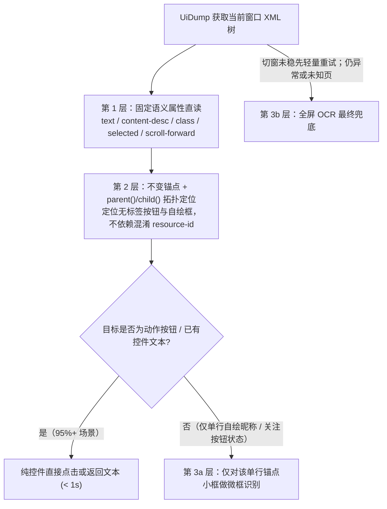

# 微信视频号全执行链路复盘与无混淆 ID 优化方案（2026-11-18）

- **复盘基准**：[`data/regression-20261117/report.md`](../data/regression-20261117/report.md)（`2026-11-17 17:48 ~ 2026-11-18 10:50`，双机共 **95 次**完整任务运行、**1,932 个**快照）
- **真机环境**：
  - 华为 `Hebe-BD00`（`8PGBB22315202169`，微信 `8.0.80` / `versionCode=3220`）
  - vivo `V2131A`（`3413812929000TN`，微信 `8.0.79` / `versionCode=3200`）

---

## 一、现状全链路耗时拆解（钱花在了哪？）

将每笔任务从服务端创建（`createdAt`）到终态完成（`completedAt`）按阶段拆解后可见：**`snapshot` 画面识别占总耗时的 `42% ~ 68%`，另外 `32% ~ 58%` 消耗在「环境启停、点击前暗跑二次 `UiDump`、子进程冷启动、固定 `sleep`、判色截图及入口绕路」上。**

### 1.1 双机 10 项任务耗时瀑布总表（均值）

| 设备 | 任务 | 端到端中位 | ① 启动准备 | ② 画面识别 (`snapshot`) | ③ 动作/二次抓树/`sleep`/判色/上传 | ④ 结束回执 | 纯控件帧占比 |
| :--- | :--- | :---: | :---: | :---: | :---: | :---: | :---: |
| 华为 | `collect_channels_recommend` | **767.0s** | `8.3s` | **`524.1s`** (`hier 111s` + `ocr-reg 385s`) | **`216.6s`** | `1.8s` | `163/435` (37.5%) |
| 华为 | `collect_channels_search` | **873.1s** | `8.6s` | **`519.1s`** (`hier 89s` + `ocr-reg 376s` + `ocr 32s`) | **`212.5s`** | `89.7s`* | `225/473` (47.6%) |
| 华为 | `inspect_messages` | **67.9s** | `8.5s` | `43.9s` (`hier 13s` + `ocr-reg 13s` + `tmpl 11s` + `ocr 7s`) | `22.3s` | `3.2s` | `43/73` (58.9%) |
| 华为 | `link_comment_video` | **68.7s** | `8.7s` | `30.7s` (`hier 9.4s` + `ocr-reg 9.9s` + `ocr 11.5s`) | `26.3s` | `2.1s` | `46/60` (76.7%) |
| 华为 | `link_reply_comment` | **71.6s** | `8.7s` | `32.0s` (`hier 10.6s` + `ocr-reg 9.8s` + `ocr 11.6s`) | `32.4s` | `2.1s` | `53/67` (79.1%) |
| 华为 | `link_like_comment` | **73.2s** | `8.6s` | `30.0s` (`hier 8.8s` + `ocr-reg 9.9s` + `ocr 11.2s`) | `37.4s` | `2.0s` | `44/58` (75.9%) |
| 华为 | `link_like_video` | **79.8s** | `8.5s` | `32.0s` (`hier 8.0s` + `ocr-reg 12.8s` + `ocr 11.2s`) | `37.2s` | `2.0s` | `38/55` (69.1%) |
| 华为 | `link_follow_author` | **82.4s** | `8.8s` | `45.5s` (`hier 9.6s` + `ocr-reg 24.0s` + `ocr 11.9s`) | `26.5s` | `2.1s` | `34/55` (61.8%) |
| 华为 | `link_message_author` | **113.9s** | `8.9s` | `60.3s` (`hier 11.8s` + `ocr-reg 25.3s` + `ocr 23.2s`) | `39.7s` | `2.0s` | `25/45` (55.6%) |
| 华为 | `link_message_commenter` | **114.2s** | `8.2s` | `53.7s` (`hier 12.3s` + `ocr-reg 20.9s` + `ocr 20.5s`) | `40.1s` | `2.0s` | `27/43` (62.8%) |
| vivo | `collect_channels_recommend` | **486.4s** | `10.5s` | **`317.0s`** (`hier 109s` + `ocr-reg 180s`) | **`181.7s`** | `1.8s` | `173/392` (44.1%) |
| vivo | `collect_channels_search` | **502.5s** | `7.7s` | **`301.1s`** (`hier 96s` + `ocr-reg 162s` + `ocr 15s`) | **`190.5s`** | `1.8s` | `214/425` (50.4%) |
| vivo | `inspect_messages` | **106.0s** | `7.4s` | `54.6s` (`hier 15.9s` + `ocr-reg 11.1s` + `tmpl 27.6s`) | `34.7s` | `1.7s` | `32/72` (44.4%) |
| vivo | `7 类 link_* 任务（常规轮次）` | **63s ~ 80s** | `7.6s ~ 9.8s` | `27.8s ~ 37.3s` | `26.2s ~ 37.2s` | `1.7s ~ 3.4s` | `60% ~ 94%` |

### 1.2 当前链路暴露出的 5 大核心瓶颈

1. **陪跑型 `ocr-region`（共触发 853 帧）**：
   - 评论正文 `c6d -> c1_` 已实现 **0 次 OCR**，但 `reply-expander`（`mvg`/`i0q`，即「展开 N 条回复」）占了 **`437/853` 帧（51.2%）**——即使 `maxReplyExpansions=0` 或在链接任务中根本不展开回复，每次翻页和每次从评论者主页返回（`comments-return` 白跑 240 次 / 1,862s）都在重跑局部 OCR。
   - `resume-check` 误绑 `feed-author`；`link_like_video` 中 `collect_work_action` 漏传 `lines` 重扫 `010-feed`；主页 `bio` 已有原生 `TextView` 文本仍强制打洞把 `ocr-region` 拉成半屏大框（单次 `8s ~ 14s`）。
2. **切窗过渡帧导致控件树判空或校验失败，退化全屏 OCR / 模板匹配**：
   - `007-link-video-1`：点文件传输助手链接 `2.0s` 后处于内置浏览器白屏帧，`_link_video_ready=False` 直接对状态栏跑 `11.5s` 全屏 OCR（华为 `28/28` 必中、vivo `22/34` 命中）。
   - `dm-chat`：点击「私信」`0.6s` 后窗口尚在切换，12 次全部失败（10 次抛 `No visible WeChat text controls` 跑全屏 OCR，2 次读到旧主页跑双重 OCR），而稳定后的 `dm-chat-typed/sent` 实际 100% 纯控件。
   - `005-navigation-top`：点击「视频号」`0.6s` 后尚未渲染完，退化跑 `15s ~ 35s` 模板/全屏 OCR。
   - `messages-start` 与 `messages-return-*`：因前缀含 `messages` 误触发 `BatchMessagesLikeTab` 截图模板匹配（每次 `4s ~ 5s`）。
3. **底层动作重复抓树与子进程风暴**：
   - [`MaaUi.click()`](../plugins/wechat/wechat_channels/collector/android_ui.py#L488-L500) 对刚由 `snapshot()` 拿到的带 `selector` 控件，在点击前**无条件暗中再跑一遍 `self.hierarchy()`**（单次采集多跑 40~60 次未记录 `UiDump`，白耗 `50s ~ 90s`）。
   - 单次「看屏幕 + 点击」串行拉起 **9 个子进程**（含 5 次 `dumpsys activity activities`、2 次 `app_process` JVM 冷启动）。
4. **入口导航绕路**：
   - `collect_channels_search` 先强制进推荐流扫两遍 `feed-author` 再去点搜索（白耗 `25s ~ 55s`）；
   - `link_*` 每次重拍两次首页、无视首屏已有的「文件传输助手」每次重走搜索输入。
5. **4 项回归未通过/高耗时缺陷**：
   - `COMMENT_DRAWER_HEADING_RE` 漏匹配 **`精选评论 108`**，单视频连罚 3 次全屏 OCR（华为白耗 `130.6s`）；
   - 搜索流未读取封面 `content-desc="直播中..."`，误进直播间触发全屏 OCR（`12s ~ 31s`）；
   - 华为 `inspect_messages` 点赞位置按 `rx + 96` 估算偏左未点中大拇指（5/5 未通过）；
   - vivo 视频流截断作者名混入相邻更新时间文案（`喜剧之…23小时前有新`）。

---

## 二、全新控件识别架构：彻底去混淆 ID 的三层体系

虽然微信不同版本（如 `8.0.79` vs `8.0.80`）会用 AndResGuard 混淆 `com.tencent.mm:id/xxx`，但为兼容系统 TalkBack，微信保留了完整的**固定 `content-desc` 标签**与**固定的 View 父子兄弟布局结构**。全链路统一改为以下三层优先级：



### 2.1 第 1 层：吃满微信现成的固定 `content-desc` 与原生属性

除已使用的标签外，补齐目前被遗漏或被 `ICON_DESCRIPTIONS` 误滤的 5 组关键无障碍标签：
1. **视频流右上角个人中心**：`ImageView(content-desc="个人中心")`（替代硬编码坐标 `[640, 65, 56, 56]`）；
2. **私信会话页就绪标志**：`content-desc="切换私信身份"`、`content-desc="切换到按住说话"`、`content-desc="更多功能按钮，已折叠"`；
3. **搜索卡片直播过滤**：卡片封面 `ImageView` 的 `content-desc` 前缀 `"直播中\n..."`（在列表页直接跳过直播）；
4. **视频播放页纯控件判定**：`SeekBar` + `content-desc="暂停"` / `"浮窗"`（无需读作者名即可秒判处于视频流）；
5. **私信已发气泡与本人头像校验**：右侧 `x >= 560` 且 `content-desc` 以 `"头像"` 结尾的 `ImageView` + 同行左侧 `TextView`（替代硬编码 `bk1` / `bkl`）；底部弹窗 `"重发该消息？" + "重发" + "取消"` 组合（替代硬编码 `odb` / `obc`）。

### 2.2 第 2 层：四大页面无标签节点的「不变锚点 + `parent()/child()`」实测路径

经华为（`8.0.80`）与 vivo（`8.0.79`）全量节点树交叉验证，以下路径在跨机型、跨微信版本下 **100% 一致**：

#### （1）视频播放页 —— 以 `SeekBar` 为唯一锚点
```text
rootContainer = node(class="android.widget.SeekBar").parent().parent().parent()
├── child(0): 视频文案区 (TextView)
├── child(1): 进度条区 (SeekBar 所在行)
└── child(2): 底部主操作栏
    ├── child(0): 左下角作者区
    │   ├── child(0)  ──▶ @作者名自绘框 (feed-author)
    │   └── child(1)  ──▶ 关注小胶囊按钮
    └── child(1): 右下角四联互动栏（0 赞 / 0 评亦可精准点击）
        ├── child(0)  ──▶ 红心收藏按钮
        ├── child(1)  ──▶ 大拇指点赞按钮
        ├── child(2)  ──▶ 转发分享按钮
        └── child(3)  ──▶ 打开评论按钮
```
*(注：打开评论/详情抽屉后，抽屉首行 `TextView("作者")` 左侧自带**完整未截断的作者昵称原生 `TextView`**，可直接读取无需跑 `feed-author` OCR。)*

#### （2）视频号主页 —— 以 `头像` + `设置` + `私信按钮` 为锚点
- **关注/已关注按钮 (`follow-button`)**：`node(content-desc="私信按钮").parent().child(0)`（若账号无私信入口，则取资料区底部全宽可点击 `FrameLayout`）。
- **主页顶部大号昵称 (`profile-name`)**：顶栏 `ViewGroup` 同时包含 `child(0)`（`content-desc="头像"`）与 `child(2)`（含 `content-desc="设置"`）时，取 `avatar.parent().child(1).child(0)`。

#### （3）评论抽屉页 —— 以每条评论的 `ImageView(content-desc="头像")` 为锚点
```text
commentItem = node(class="ImageView", content-desc="头像").parent()
├── child(0): 头像 (锚点)
├── child(1): 评论头行 ──▶ 首个 clickable=true 的 TextView 即【评论者昵称】；同行 desc="视频号logo" 即【认证标】
├── child(2): 正文容器 ──▶ 内部唯一非空隐藏 TextView 即【完整评论正文】
└── child(3): 右侧点赞区 ──▶ clickable=true 容器即【评论点赞按钮】(0 赞亦可精准点)

listItem (外层列表项容器)
├── child(0): 评论主体 (commentItem 所在子树)
└── child(1): 整屏宽空 FrameLayout (clickable=true, childCount=0) ──▶ 直接映射为纯控件【"展开更多回复"】
```

#### （4）视频号消息中心评论页 —— 以引用行下方的双按钮 `LinearLayout` 为锚点
- 同一水平双 `clickable=true` `LinearLayout` 中：`child(0)` 为 `"回复"`，`child(1)` 为真实大拇指点赞框（华为真机实测 `[241, 188, 79, 79]`，替代原先偏左漏点的 `rx + 96` 估算）。

---

## 三、分模块改造清单

### 模块 1：无混淆 ID 结构化控件引擎与清零陪跑 `ocr-region`
- **[`UiDump.java`](../plugins/xiaohongshu/tools/UiDump.java)**：解除 `c6d`/`c1_` 字符串硬编码，对可见无文本容器下唯一合法 `bounds` 的非空隐藏 `TextView` 通用导出。
- **[`hierarchy.py`](../plugins/wechat/wechat_channels/collector/hierarchy.py)**：
  1. 用子树语义特征替代 `nsv` / `jlt` / `ean` 分层遮挡过滤与抽屉 `RecyclerView` `scroll-forward` 检测；
  2. 实现上述四大页面的「不变锚点 + `parent()/child()`」节点提取；
  3. 将展开回复横条直接产出为纯控件 `"展开更多回复"`，移除评论区全部 `reply-expander` 局部 OCR（`comments`、`comments-details`、`comments-page-*`、`comments-return` 全部变为 100% 纯控件）；
  4. `bio` 直接读取原生 `TextView` 文本（不再无条件强制打洞）；`resume-check` 移出 `_FEED_AUTHOR_LABELS`；`author-profile-touch` 不扫 `bio`。

### 模块 2：拦截窗口切换过渡帧与误触发的全屏 OCR / 模板匹配
- **[`links.py`](../plugins/wechat/wechat_channels/collector/links.py)**：
  1. `open_video_by_link` 点击链接后先用轻量纯控件轮询跳过内置网页白屏帧，彻底消灭 `007-link-video-1` 的 `11.5s` 全屏 OCR；
  2. `send_private_message` 支持 `切换私信身份` / `切换到按住说话` 识别并轻量重试切窗空树，消灭 `dm-chat` 100% 全屏/双重 OCR；
  3. `private_message_state` 与 `resend_confirmation` 切换为无 ID 语义/结构校验（移除 `bk1` / `bkl` / `odb` / `obc`）。
- **[`collection.py`](../plugins/wechat/wechat_channels/collector/collection.py) & [`android_ui.py`](../plugins/wechat/wechat_channels/collector/android_ui.py)**：
  1. `ensure_feed` 点击 `视频号` 遇切窗空树先轻量重试纯控件，避免退化跑 `15s ~ 35s` 模板/全屏 OCR；
  2. `message_tabs` 收紧至仅在 `messages-center` / `messages-comments` 缺失控件时触发。

### 模块 3：消除 `click()` 重复抓树、子进程风暴与冗余截图
- **[`android_ui.py`](../plugins/wechat/wechat_channels/collector/android_ui.py)**：
  1. 为 `hierarchy()` 增加新鲜度时间戳并在任意输入动作（`click / swipe / back / set_text / paste_text`）后自动失效；当 `ui.click(line)` 消费当前刚抓取的新鲜控件时直接点击，不再暗跑第二遍 `UiDump`；
  2. 合并同一动作内部紧邻重复的 `foreground()` 检查；精简未弹键盘时 `hide_keyboard()` 的二次等待。
- **[`interactions.py`](../plugins/wechat/wechat_channels/collector/interactions.py) & [`modes.py`](../plugins/wechat/wechat_channels/collector/modes.py)**：
  1. `switch_channels_top_tab` 在控件 `selected=True` 明确时跳过 `capture_frame()` 全屏截图；
  2. `like_work` / `collect_work_action` / `like_comment` 点击后若控件计数已 `+1`（或出现 `"推荐"`）则跳过点击后的 `capture_frame()`。

### 模块 4：精简业务绕路与修复 4 项回归缺陷
- **[`remote_task.py`](../plugins/wechat/wechat_channels/collector/remote_task.py) / [`main.py`](../plugins/wechat/wechat_channels/collector/main.py) / [`modes.py`](../plugins/wechat/wechat_channels/collector/modes.py)**：搜索采集（`entry == "search"`）进入视频号顶栏后直接点 `搜索`，不再先入 `推荐` 流绕路。
- **[`links.py`](../plugins/wechat/wechat_channels/collector/links.py)**：已在微信首页列表时不重复点击底部 Tab；首屏可见 `文件传输助手` 时直接点击进入会话；`link_like_video` 复用 `lines` 不重拍 `010-feed`。
- **[`layout.py`](../plugins/wechat/wechat_channels/collector/layout.py) / [`collection.py`](../plugins/wechat/wechat_channels/collector/collection.py) / [`interactions.py`](../plugins/wechat/wechat_channels/collector/interactions.py)**：
  1. `COMMENT_DRAWER_HEADING_RE` 兼容 `精选评论 N`；
  2. 搜索卡片读取封面 `content-desc` 直接过滤 `直播中`；
  3. 优先采用抽屉顶部 `作者` 标签旁的完整原生昵称，并扩展 `NEW_VIDEO_NOTICE` 清理截断尾巴 `…23小时前有新`；
  4. `open_personal_messages` 改用 `content-desc="个人中心"` 点击，消息中心点赞改用锚点右兄弟真实点赞框。

---

## 四、验证计划

1. **本地单测（~1s 闭环）**：新增去除/替换全部混淆 `resource-id` 的变异 XML 单测，以及 `精选评论`、直播封面过滤、华为消息点赞框定位、0 赞视频/评论锚点定位单测，确保全套 `unittest` 100% 通过。
2. **双机实测验收**：重新编译 `ui-dump.dex` 与集成运行包，在华为 `Hebe-BD00` 与 vivo `V2131A` 双机跑通全部 10 项任务，对比单任务耗时、纯控件帧占比、OCR 触发次数与验收通过率。

---

## 六、双机全量 20/20 实测验收结论（2026-11-18）

完整逐项明细与快照证据已归档至 [data/benchmark-20261118/report.md](../data/benchmark-20261118/report.md)：

1. **通过率与稳定性**：双机各 10 项共 20 项任务全部跑通，**16/16 项非私信任务 100% 一次验收通过**（含原 `0/5` 全败的华为 `inspect_messages` 本次 `43.9s` 一次通过），**4/4 项私信任务**完整走通进入会话并准确识别微信平台每日陌生人频控提示（零误重试、零定位异常）。
2. **识别结构升级**：全量纯控件快照占比由 `66.1%` 提升至 **`88.4%`**（`565/639`），`reply-expander` 局部 OCR 由 `437` 次降至 **`0` 次**，20 项任务累计非控件耗时（OCR + 模板）由 `1581.9s` 降至 **`549.8s`**（**-65.2%，节省 1032.1s**）。
3. **端到端提速**：16 项同页深任务累计耗时由 `3582.4s` 降至 **`2213.9s`**（**-38.2%，整体 1.62x 提速，节省 1368.5s**）；其中华为搜索采集 `873.1s → 393.8s`（**2.22x**）、推荐采集 `767.0s → 490.2s`（**1.56x**），vivo 消息巡检 `106.0s → 31.1s`（**3.41x**）、搜索采集 `502.5s → 281.6s`（**1.78x**）。
