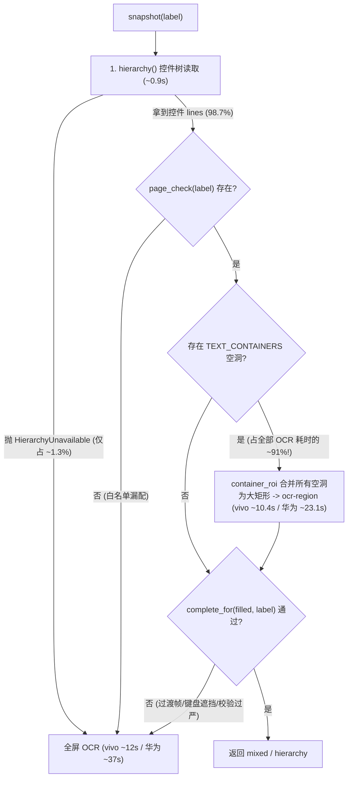

# 微信视频号双机运行日志复盘：OCR 触发场景、耗时拆解与提速优化报告（2026-11-17）

- **分析日期**：2026-11-17
- **日志范围**：`2026-11-12` 至 `2026-11-17 12:06`（重点聚焦最新代码周期 `2026-11-16 ~ 2026-11-17`）
- **数据来源**：
  1. **手机 1（vivo V2131A / `3413812929000TN`）**：`/data/local/tmp/wechat-channels-data/remote/*/runs`（共 `436` 次运行、`6,819` 个快照；其中 `2026-11-17` 当日 **`340` 次运行 / `3,924` 个快照**）及 `top.natsuu.mta.wechat_channels.integration` 内 `maa-logs/maafw.log`。
  2. **手机 2（华为/荣耀 Hebe_BD00 `TINA-AN00` / `8PGBB22315202169`）**：`/data/local/tmp/wechat-channels-data/remote/*/runs`（共 `171` 次运行、`3,036` 个快照；其中 `2026-11-17` 当日 **`41` 次运行 / `1,425` 个快照**）及 `top.natsuu.mta.wechat_channels.integration` 内 `maa-logs/maafw.log`。

---

## 一、核心结论速览：OCR 花了多少时间？

> **核心发现**：两台手机的无障碍控件读取（`hierarchy` / `UiDump`）中位耗时仅 **`0.86s ~ 0.89s`**，且成功率超过 **98.5%**；但系统仍有约 **`45% ~ 52%`** 的快照触发了 `ocr-region`（局部空洞补全）或全屏 `ocr` 回退，单次耗时高达 **`10s ~ 66s`**，直接占用了单次任务总耗时的 **`50% ~ 75%`**。

### 1.1 单次识别机制耗时对比（`2026-11-17` 最新代码实测）

| 识别机制 | vivo V2131A (`3413812929000TN`) | 华为 Hebe_BD00 (`8PGBB22315202169`) | 对比纯控件耗时倍数 |
| :--- | :--- | :--- | :--- |
| **`hierarchy`（纯控件 `UiDump`）** | `n=3,750`，**p50 = `866ms`**，mean = `1,193ms`，p90 = `2,253ms`，累计 `4,474.6s` | `n=1,266`，**p50 = `894ms`**，mean = `1,050ms`，p90 = `1,738ms`，累计 `1,328.9s` | **基准 (1x)** |
| **`ocr-region`（空容器补洞 OCR）** | `n=1,435`，**p50 = `10,400ms`**，mean = `10,103ms`，p90 = `13,177ms`，max = `20,980ms`，累计 `14,497.7s` | `n=711`，**p50 = `23,103ms`**，mean = `21,283ms`，p90 = `30,665ms`，max = `37,291ms`，累计 `15,132.2s` | vivo 慢 **12x** / 华为慢 **26x** |
| **`ocr`（全屏回退 OCR）** | `n=108`（近两日 `n=231`），今日 **p50 = `11,394ms`**，近两日 **p50 = `16,118ms`**，p90 = `25,721ms`，max = `30,113ms` | `n=56`（近两日 `n=172`），近两日 **p50 = `36,619ms`**，mean = `33,150ms`，p90 = `53,872ms`，max = **`70,777ms`** | vivo 慢 **18x** / 华为慢 **41x** |
| **双重 OCR（`ocr-region` + 全屏 `ocr`）** | 今日 `n=19`（累计 `n=65`），**p50 = `24.4s ~ 31.7s`**，max = `38.9s` | 今日 `n=14`（累计 `n=40`），**p50 = `65.8s ~ 66.4s`**，max = **`96.9s`** | 华为单步卡死 **1 分钟+** |

### 1.2 各任务端到端耗时中 OCR 占比（`2026-11-17`）

| 任务类型 (`task`) | vivo 运行数 | vivo 平均总跨度 | vivo 平均 OCR (占比) | 华为运行数 | 华为平均总跨度 | 华为平均 OCR (占比) |
| :--- | :---: | :---: | :---: | :---: | :---: | :---: |
| `link_like_comment`（指定评论点赞） | 44 | `76.6s` | **`40.5s` (53%)** | 6 | `140.0s` | **`101.0s` (72%)** |
| `link_reply_comment`（指定评论回复） | 42 | `62.7s` | **`31.8s` (51%)** | 3 | `112.0s` | **`81.9s` (73%)** |
| `link_follow_author`（关注视频作者） | 46 | `67.6s` | **`34.3s` (51%)** | 4 | `110.0s` | **`77.5s` (70%)** |
| `link_like_video`（视频点赞和红心） | 45 | `71.3s` | **`33.9s` (47%)** | 5 | `129.2s` | **`85.9s` (66%)** |
| `link_comment_video`（评论视频） | 45 | `45.1s` | **`18.4s` (41%)** | 5 | `134.8s` | **`99.8s` (74%)** |
| `link_message_commenter`（私信评论者） | 36 | `79.6s` | **`32.5s` (41%)** | 7 | `121.6s` | **`76.6s` (63%)** |
| `link_message_author`（私信作者） | 45 | `70.6s` | **`23.9s` (34%)** | 5 | `96.4s` | **`53.5s` (55%)** |
| `collect_channels` / 批量采集 | 16 | `693.5s` | **`403.9s` (58%)** | 1 | `42,325s` (11.7h) | **`13,168s` / 3.66h (31%)** |

### 1.3 单次 `ocr_snapshot` 内部耗时拆解（基于 `maafw.log` 原生埋点）

结合原生日志 `maa-logs/maafw.log` 与 [`android_ui.py`](../plugins/wechat/wechat_channels/collector/android_ui.py#L300-L338)，单次 OCR 调用由三部分叠加而成：

1. **截图与跨进程传输（`controller.post_screencap().wait()` + Agent IPC）**：
   - vivo 约 **`2.4s ~ 2.7s`**（如 `12:03:12.244` 发起截图 → `12:03:14.916` 进入识别，耗时 `2,672ms`）。
   - 华为约 **`2.1s ~ 2.5s`**。
   - 对比：纯控件 `hierarchy` 完全不截图，此项开销为 **`0ms`**。
2. **Python 全图内存拷贝与橙色徽章掩码**：
   - [`android_ui.py`](../plugins/wechat/wechat_channels/collector/android_ui.py#L312-L318) 在 `comments*` / `messages*` 标签下未先裁剪 ROI，直接对整张图做 `image.copy()` 和三通道 `int16` 矩阵运算。
3. **MaaFramework 原生 CPU 推理（`OCRer::analyze()`，PP-OCR 检测 + 识别）**：
   - **vivo V2131A**：半屏评论区 `roi=[29, 739, 663, 613]` 推理净耗时 **`6,656ms`**（总计 `~10.4s`）。
   - **华为 Hebe_BD00**：同尺寸半屏评论区 `roi=[29, 795, 663, 662]` 推理净耗时 **`24,817ms`**（总计 `~27s~29s`）；全屏带软键盘页面推理高达 **`52s ~ 69.5s`**。
   - **无效识别浪费**：`maafw.log`（`12:06:29`）实测显示，上述 `663x662` 区域内 PP-OCR 共检测并逐一识别了 **24 个文本框**，其中 **18 个是原生控件树早已精确拿到的评论者昵称/时间行（如 `王秀英7362四川5天前`）、点赞数字和左侧头像杂字**，识别完后在 [`fill_containers`](../plugins/wechat/wechat_channels/collector/hierarchy.py#L232) 中被当场丢弃，真正留用的只有 4 行 `c6d` 评论正文。

---

## 二、哪些情况下使用了 OCR 而没用纯控件？（5 大根因分类）

当前快照识别主流程位于 [`choose_snapshot`](../plugins/wechat/wechat_channels/collector/hierarchy.py#L578-L601)：

对两台手机全部快照按实际执行路径归类，触发 OCR 的情况完全落入以下 **5 类**：

| 根因分类 | vivo 今日次数 / 耗时 (占比) | 华为今日次数 / 耗时 (占比) | 触发本质 |
| :--- | :--- | :--- | :--- |
| **类别 1a：`mixed` 容器补洞 (`ocr-region`)** | `1,407次` / **`14,324.2s` (90.9%)** | `692次` / **`14,916.6s` (91.4%)** | 控件树成功，但页面含 `TEXT_CONTAINERS` 自绘节点，无差别合并跑大框 `ocr-region` |
| **类别 1b：纯空跑 `ocr-region`（0 填充）** | `9次` / `55.3s` (`0.4%`)（累计 `23次/111.2s`） | `5次` / `64.3s` (`0.4%`)（累计 `21次/166.9s`） | 控件树含空洞触发了 `ocr-region`，结果 1 个有效字都没填进去，最终返回纯 `hierarchy` |
| **类别 2：双重 OCR（`ocr-region` + 全屏 `ocr`）** | `19次` / **`428.9s` (2.7%)**（累计 `65次/1915.3s`） | `14次` / **`739.8s` (4.5%)**（累计 `40次/2308.3s`） | 跑完控件 + `ocr-region` 后 `complete_for` 仍不通过（如未退回视频流、误弹软键盘），再罚一次全屏 OCR |
| **类别 3：`complete_for=False` 回退全屏 `ocr`** | `40次` / **`381.4s` (2.4%)**（累计 `180次/2846.1s`） | `35次` / **`463.7s` (2.8%)**（累计 `208次/6398.1s`） | 控件树成功且无空洞，但处于网页加载白屏帧（如 `link-video-1`）或页面校验不匹配，触发全屏 OCR |
| **类别 4：`HierarchyUnavailable` 回退全屏 `ocr`** | `49次` / **`565.1s` (3.6%)** | `7次` / **`135.4s` (0.8%)** | `UiDump` 6s 超时（vivo 长列表偶发）或窗口切换瞬间无可见微信文本控件 |

---

### 详细拆解各高频误用/滥用 OCR 的具体业务步骤

#### 1. `comments-return`：评论者主页返回原位重复重扫同一屏（双机总耗时第 1 名）
- **实测数据**：
  - vivo：今日 `127次 / 1,394.5s`（p50 `11.0s`）；近两日 `577次 / 7,158.4s`（**近 2 小时**）。
  - 华为：今日 `249次 / 6,874.6s`（p50 **`28.0s`**）；近两日 `285次 / 7,688.8s`（**2.1 小时**）。
- **代码位置**：[`comments.py`](../plugins/wechat/wechat_channels/collector/comments.py#L1180-L1207)
- **为什么没用纯控件**：
  - 进入当前评论页时，`comments` 或 `comments-page-N` **已经跑过一次 `ocr-region` 并把当页所有评论正文（`c6d`）存入 `collected`**。
  - 随后循环访问当页评论者主页，每次 `back()` 返回原位都调用 `ui.snapshot("comments-return")`。由于 `"comments-return"` 在 [`CONTROL_PAGES`](../plugins/wechat/wechat_channels/collector/hierarchy.py#L515) 中绑定了 `_comments_ready` 且未排除 `c6d` 容器，系统把**完全未滚动的同一屏评论正文反反复复重跑 `ocr-region`**（一页访问 5 个评论者就重扫 5 遍，华为单页白耗 **140 秒**），而后续点击下一个评论者所需的昵称坐标 `_nameBox` 与抽屉标题 `评论 N` **100% 都在 `hierarchy` 控件中**。

#### 2. `comments-locate-*` / `comments-after-like` / `comments-composer` / `comments-typed`：按昵称找评论、校验点赞与输入发送
- **实测数据**：
  - `comments-locate-*`：vivo 今日 **`355次 / 3,707.7s`**（p50 `10.3s`）；华为今日 `14次 / 344.6s`（p50 `26.8s`，累计 `85次 / 2,969.3s`）。
  - `comments-after-like`：vivo 今日 `21次 / 253.1s`（p50 `12.5s`）；华为今日 `4次 / 117.1s`（p50 **`31.5s`**）。
  - `comments-composer` / `comments-typed` / `comments-reply-*`：华为单次 `9.9s ~ 11.6s`，且多次因键盘遮挡产生 0 填充空跑。
- **代码位置**：[`interactions.py`](../plugins/wechat/wechat_channels/collector/interactions.py#L731-L736)、[`interactions.py`](../plugins/wechat/wechat_channels/collector/interactions.py#L790-L803)、[`interactions.py`](../plugins/wechat/wechat_channels/collector/interactions.py#L869-L914)
- **为什么没用纯控件**：
  - 链接任务（`link_like_comment` / `link_reply_comment` / `link_message_commenter`）通常只按 **`nickname`（评论者昵称）** 匹配目标评论，不匹配 `content`。评论者昵称、时间戳、右上角点赞数、底部 `EditText` 输入框和 `发送` 按钮 **100% 在原生控件树中**，却因统一走 `snapshot("comments*")` 每翻一页都把整屏 `c6d` 评论正文 OCR 一遍。

#### 3. `video-details` 与 `share-paste-*` / `share-return-*`：作品详情与剪贴板取短链连环 OCR
- **实测数据**：
  - `video-details`：vivo 累计 `35次 / 349.3s`（p50 `10.5s`）；华为累计 `28次 / 553.8s`（p50 `21.2s`）。
  - `share-paste-drawer` + `share-link-paste-composer` + `share-link-cleared` + `share-return-*`：华为在搜索流单次复制短链，光这组步骤就会烧掉 **`23.8s + 13.1s + 12.3s + 66.4s(双重OCR) + 21.9s = 137.5s`（2 分 17 秒）**！
- **代码位置**：[`collection.py`](../plugins/wechat/wechat_channels/collector/collection.py#L423-L515)、[`collection.py`](../plugins/wechat/wechat_channels/collector/collection.py#L602-L640)
- **为什么没用纯控件**：
  1. `video-details` 打开半屏抽屉只读顶部的作品文案、发布时间、IP 属地——日志 `015-video-details.json` 证实这些字段 **100% 由原生控件直接返回**，但因为抽屉下半截露出了几条评论的 `c6d` 空容器，白跑半屏 OCR。
  2. `_paste_into_composer` 借用评论输入框粘贴读取剪贴板链接时，只需要操作原生 `EditText` 控件，却连续 3 次对背后的 `c6d` 评论容器跑 `ocr-region`。
  3. 粘贴完调 [`back_to_video`](../plugins/wechat/wechat_channels/collector/collection.py#L463-L477) 退出时，第 1 下 `back()` 仅收起键盘、页面仍在评论抽屉；由于 `"share-return-"` 绑定了 `_feed_or_search_ready`，校验失败后先跑 `ocr-region`（`4s~16s`），紧接着再跑**全屏带键盘 `ocr`（华为 `62s`、vivo `28s`）**，耗时一分钟仅仅为了确认“还没回到视频页，需要再按一下 `back()`”。

#### 4. `link-video-*` 与视频播放流系列（`feed*` / `before-author` / `share-closed` / `navigation-top` / `resume-check`）
- **实测数据**：
  - `link-video-*`：vivo 今日 **`338次 / 3,927.5s`**（第 1 名，其中 `294次` `ocr-region` p50 `11.6s`、`45次` 全屏 `ocr` p50 `10.3s`）；华为今日 **`69次 / 1,078.6s`**（`36次` `ocr-region` p50 `20.8s`、`33次` 全屏 `ocr` p50 `10.7s`）。
  - `feed` / `before-author` / `feed-after-like` / `feed-after-collect` / `feed-after-author-touch` / `share-closed`：每次固定触发 `ocr-region`（vivo `10.5s`，华为 `19s ~ 22s`）。
- **代码位置**：[`links.py`](../plugins/wechat/wechat_channels/collector/links.py#L260-L281)、[`hierarchy.py`](../plugins/wechat/wechat_channels/collector/hierarchy.py#L24-L28)
- **为什么没用纯控件**：
  1. **网页跳转白屏帧误跑全屏 OCR**：点击「文件传输助手」里的链接后 `2.0s` 首次检查 `link-video-1` 时，微信往往还在内置浏览器白屏跳转页（控件仅有左上角 `X`）。`_feed_ready` 失败后，`choose_snapshot` 对着空白加载页跑 `10.5s` 全屏 OCR。
  2. **底部 `kp7`（`弹`）把小框拉成全屏大框**：视频流上真正自绘的只有左下角单行作者名 `dzo`（仅 `~220x38` 像素），但进度条旁的弹幕开关复用了资源 ID `kp7`（在评论区代表 `reply-expander`），导致 `container_roi` 把 `dzo` 和底部 `kp7` 合并成大区域；而且 `feed-after-like` / `feed-after-collect` / `share-closed` / `navigation-top` 等步骤其实根本不需要重读作者名。

#### 5. `commenter-profile` 误触软键盘引发双重 OCR（最高 `96.9s`）
- **实测数据**：vivo 累计 `28次`、华为累计 `6次` 触发 `hierarchy + ocr-region + full ocr`（vivo `30s~39s`，华为 `65s~96.9s`）。
- **原因**：点击评论者昵称偶发唤醒回复输入法（控件出现 `EditText` / 键盘按键 `q/w/123`），`_profile_or_card_ready` 判定不是主页后，系统未短路退出，反而对着满屏 40+ 个软键盘按键跑全屏 PP-OCR。

---

## 三、双机 Top 15 高耗时 `label` 明细表（`2026-11-16 ~ 2026-11-17` 最新代码周期）

### 3.1 vivo V2131A (`3413812929000TN`)

| 排名 | 快照标签 (`label`) | OCR 总耗时 | 触发次数 | 单次均值 | 单次 p50 | 最终来源分布 (`source`) |
| :---: | :--- | :---: | :---: | :---: | :---: | :--- |
| 1 | `comments-return` | **7,158.4s** | 577 | 12,406ms | 12,351ms | `mixed`: 557, `ocr`: 20 |
| 2 | `comments-page-*` | **4,157.6s** | 333 | 12,485ms | 11,911ms | `mixed`: 304, `ocr`: 24, `hierarchy`: 5 |
| 3 | `link-video-*` | **3,983.2s** | 343 | 11,613ms | 11,539ms | `mixed`: 298, `ocr`: 45 |
| 4 | `comments-locate-*` | **3,707.7s** | 355 | 10,444ms | 10,295ms | `mixed`: 355 |
| 5 | `commenter-profile` | **2,649.8s** | 364 | 7,280ms | 4,721ms | `mixed`: 330, `hierarchy`: 274, `ocr`: 34 |
| 6 | `comments` | **1,663.6s** | 159 | 10,463ms | 10,456ms | `mixed`: 159 |
| 7 | `feed` | **857.2s** | 80 | 10,715ms | 10,443ms | `mixed`: 79, `ocr`: 1 |
| 8 | `author-profile-touch` | **763.1s** | 92 | 8,295ms | 6,889ms | `mixed`: 86, `ocr`: 6 |
| 9 | `feed-after-author-touch` | **499.8s** | 46 | 10,865ms | 10,602ms | `mixed`: 46 |
| 10 | `comments-recover` | **453.4s** | 36 | 12,594ms | 13,304ms | `mixed`: 34, `ocr`: 2 |
| 11 | `comments-after-like` | **253.1s** | 21 | 12,052ms | 12,458ms | `mixed`: 21 |
| 12 | `feed-after-collect` | **241.6s** | 21 | 11,503ms | 10,755ms | `mixed`: 20, `ocr`: 1 |
| 13 | `feed-after-like` | **222.2s** | 21 | 10,581ms | 10,465ms | `mixed`: 21 |
| 14 | `dm-chat` | **203.3s** | 16 | 12,704ms | 14,389ms | `hierarchy`: 57, `ocr`: 16 |
| 15 | `comments-replies` | **153.1s** | 10 | 15,313ms | 16,046ms | `mixed`: 10 |

### 3.2 华为 Hebe_BD00 (`8PGBB22315202169`)

| 排名 | 快照标签 (`label`) | OCR 总耗时 | 触发次数 | 单次均值 | 单次 p50 | 最终来源分布 (`source`) |
| :---: | :--- | :---: | :---: | :---: | :---: | :--- |
| 1 | `comments-return` | **7,688.8s** | 285 | 26,978ms | 27,517ms | `mixed`: 284, `ocr`: 1 |
| 2 | `comments-page-*` | **3,491.3s** | 126 | 27,709ms | 27,917ms | `mixed`: 120, `ocr`: 6 |
| 3 | `comments-locate-*` | **2,449.4s** | 68 | 36,020ms | 37,719ms | `mixed`: 53, `ocr`: 15 |
| 4 | `commenter-profile` | **2,196.0s** | 183 | 12,000ms | 8,745ms | `mixed`: 177, `hierarchy`: 128, `ocr`: 6 |
| 5 | `share-return-*` | **1,558.6s** | 39 | 39,965ms | 25,128ms | `mixed`: 35, `ocr`: 4（含大量双重 OCR） |
| 6 | `link-video-*` | **1,241.9s** | 77 | 16,129ms | 17,243ms | `mixed`: 44, `ocr`: 33, `hierarchy`: 1 |
| 7 | `comments` | **898.1s** | 40 | 22,453ms | 23,184ms | `mixed`: 40, `hierarchy`: 1 |
| 8 | `feed` | **754.6s** | 40 | 18,864ms | 19,084ms | `mixed`: 40 |
| 9 | `search-cards-scroll-*` | **694.5s** | 18 | 38,586ms | 38,561ms | `ocr`: 18, `hierarchy`: 2（`d232397` 已补白名单） |
| 10 | `search-opened-video-*` | **271.6s** | 13 | 20,895ms | 22,472ms | `mixed`: 8, `ocr`: 5 |
| 11 | `comments-recover` | **253.8s** | 8 | 31,720ms | 27,716ms | `mixed`: 6, `ocr`: 2 |
| 12 | `share-closed` | **250.5s** | 13 | 19,266ms | 19,027ms | `mixed`: 13 |
| 13 | `share-feed` | **248.5s** | 13 | 19,113ms | 19,579ms | `mixed`: 13 |
| 14 | `before-author` | **234.6s** | 13 | 18,049ms | 17,598ms | `mixed`: 13 |
| 15 | `video-details` | **232.4s** | 13 | 17,874ms | 17,841ms | `mixed`: 13, `hierarchy`: 2 |

---

## 四、分阶段提速优化路线图

预计全部落地后可消除 **80% ~ 90%** 的 OCR 调用，整体任务速度提升 **`2.5x ~ 4x`**（华为单次链接任务预计从 `110~140s` 降至 `25~35s`；vivo 从 `62~79s` 降至 `18~28s`）。

### P0：按 `label` 收紧所需自绘容器（`allowed_containers`），消灭陪跑型 `ocr-region`（收益最高，立省 ~65% OCR 时间）
修改 [`hierarchy.py`](../plugins/wechat/wechat_channels/collector/hierarchy.py) 中 `container_roi` / `choose_snapshot` 与上层调用参数：
1. **设为零容器（`containers = ()`，强制纯控件 `<0.9s` 返回）**：
   - 评论返回与状态核对：`comments-return`、`comments-after-skip`、`comments-after-like`、`comments-composer`、`comments-typed`、`comments-reply-composer`、`comments-reply-typed`。
   - 详情与短链粘贴：`video-details`、`expanded-description`、`share-paste-drawer`、`share-link-paste-composer`、`share-link-cleared`、`share-closed`。
   - 导航与动作后校验：`navigation-top`、`navigation-bottom`、`resume-check`、`feed-after-like`、`feed-after-collect`、`feed-after-author-touch`（已知 `author` 时直接校验底部交互控件）。
   - 按昵称定位评论：[`locate_target_comment`](../plugins/wechat/wechat_channels/collector/interactions.py#L820) 当 `target_spec` 仅含 `nickname` 不含 `content` 时，传无正文容器标签（如 `comments-locate-nick-*`），完全跳过 `comment-body` OCR。
2. **视频流剔除 `kp7` 干扰，仅保留 `{"feed-author"}` 单行小框**：
   - 对 `feed`、`before-author`、`link-video-*`、`share-feed`、`search-opened-video-*`，只对 `dzo`（`feed-author`，约 `220x38` 像素）裁剪识别，忽略播放页底部的 `kp7`（`弹`），ROI 面积缩小 **90%+**。
3. **主页按需裁剪按钮与昵称**：
   - `profile-follow-check` / `profile-after-follow` / `author-profile-touch` 在仅执行关注/私信且无需采集长简介时，排除 `bio` 容器，仅识别 `profile-name` / `follow-button` / `message-button`。

### P1：拦截过渡帧与软键盘误触，彻底消灭双重 OCR 与空白页全屏 OCR
1. **`share-return-*` 改为 `_known_page`（且 `containers=()`）**：
   - 在 [`CONTROL_PAGES`](../plugins/wechat/wechat_channels/collector/hierarchy.py#L546) 中允许 `share-return-*` 在仍处于 `comment_drawer` / `composer_overlay` 时直接通过控件校验返回，让 [`back_to_video`](../plugins/wechat/wechat_channels/collector/collection.py#L463-L477) 在 `<1s` 内立即发出下一次 `back()`，消除每次 `60s+` 的双重 OCR。
2. **`link-video-*` 识别内置浏览器跳转白屏帧**：
   - 在 [`open_video_by_link`](../plugins/wechat/wechat_channels/collector/links.py#L266-L281) 中先快速用纯控件检查是否仍处于无视频号元素的内置网页加载态（如仅有左上角关闭按钮），若是则直接 `sleep(0.8s)` 重试控件，不对白屏跑 `10.5s` 全屏 OCR。
3. **非输入态遇到软键盘/聚焦 `EditText` 直接短路**：
   - 当 `commenter-profile` 等页面在控件树中检测到软键盘或评论回复 `EditText` 时，直接返回当前控件快照交由恢复逻辑 `back()` 关闭键盘，禁止降级跑全屏键盘 OCR。

### P2：评论正文 `ocr-region` 图像预处理加速（针对必须读正文的 `comments` / `comments-page-*` 再提速 `2x ~ 4x`）
1. **先裁 ROI 再做橙色徽章掩码**：在 [`ocr_snapshot`](../plugins/wechat/wechat_channels/collector/android_ui.py#L312-L318) 中仅对 `roi` 子切片做拷贝与橙色像素替换，避免全屏数组拷贝。
2. **已知控件涂白遮罩（Pre-OCR Hole Masking）+ 左右窄化**：
   - 在评论抽屉 `ocr-region` 送入 `OCRer` 前，将非 `c6d` 空洞区域（如已由 `hierarchy` 拿到的昵称时间行、左侧头像列 `x < 96`、右侧点赞列 `x > 630`）涂白（`255`），使 DBNet + CRNN 识别框数从 ~24 个降至 3~5 个纯正文框，可将华为单页评论 OCR 从 `~25s` 压至 `~6s~8s`。

### P3：补齐残余边界状态白名单
- 在 [`classify_page_state`](../plugins/wechat/wechat_channels/collector/interactions.py#L393) 中补充无视频号账号的「我的视频号 / 创建账号」个人页特征，消除 `messages-return-*` 的全屏 OCR 回退。
- 放宽 `messages-reply-composer` 下 `composer_overlay` 的控件判定，消除消息中心回复时的全屏 OCR 回退。

---

## 六、纯控件优先改造落地与双机全部 10 项任务基准实测对比

在完成 [UiDump.java](../plugins/xiaohongshu/tools/UiDump.java)（导出可见 `c6d` 下的评论正文 `c1_` + 输入法焦点窗口回退抓取微信应用树）与 [hierarchy.py](../plugins/wechat/wechat_channels/collector/hierarchy.py)（直读 `lz3`/`kr`/`mld`、移除误配的 `kp7`、修正回复展开条 `mvg`/`i0q`、按步骤按需裁剪仅剩的 5 个自绘小框 + 两级 OCR 兜底）改造后，在两台真机上对系统**全部 10 个业务任务**进行了端到端实测对比：

### 1. 华为/荣耀 `Hebe_BD00` (`8PGBB22315202169`) 全任务耗时对比

| 业务任务 | 改造前总耗时 (中位) | 改造后实测总耗时 | 总提速 | 改造前 OCR 耗时 | 改造后 OCR 耗时 | OCR 降幅 | 改造后快照分布 (`hierarchy` / `mixed` / 全屏 `ocr`) |
| :--- | :---: | :---: | :---: | :---: | :---: | :---: | :---: |
| `collect_channels (recommend, n=1)` | `334.7 s` | **`123.8 s`** | **2.7x** | `223.3 s` | **`9.5 s`** | **-95.7%** | `19 / 9 / 0`（共 28 帧，**0 全屏 OCR**） |
| `collect_channels (search, n=1)` | `625.5 s` (10.4分) | **`119.6 s`** (2.0分) | **5.2x** | `516.3 s` | **`7.9 s`** | **-98.5%** | `24 / 12 / 0`（共 36 帧，**0 全屏 OCR**） |
| `inspect_messages` | `180.4 s` | **`41.6 s`** | **4.3x** | `127.5 s` | **`5.3 s`** | **-95.8%** | `11 / 3 / 1`（共 15 帧） |
| `link_like_video` | `125.4 s` | **`35.6 s`** | **3.5x** | `79.6 s` | **`4.3 s`** | **-94.6%** | `6 / 1 / 1`（共 8 帧） |
| `link_follow_author` | `111.2 s` | **`47.5 s`** | **2.3x** | `78.3 s` | **`5.9 s`** | **-92.5%** | `6 / 3 / 1`（共 10 帧） |
| `link_comment_video` | `117.7 s` | **`44.3 s`** | **2.7x** | `86.6 s` | **`1.0 s`** | **-98.8%** | `10 / 1 / 0`（共 11 帧，**0 全屏 OCR**） |
| `link_like_comment` | `116.2 s` | **`60.3 s`** *(翻6页)* | **1.9x** | `80.5 s` | **`1.0 s`** | **-98.8%** | `15 / 1 / 0`（共 16 帧，**0 全屏 OCR**） |
| `link_reply_comment` | `125.1 s` | **`67.8 s`** *(翻6页)* | **1.8x** | `82.9 s` | **`2.7 s`** | **-96.7%** | `16 / 2 / 0`（共 18 帧，**0 全屏 OCR**） |
| `link_message_author` *(注)* | `147.2 s` | **`89.9 s`** *(去重发等待约 `44s`)* | **1.6x ~ 3.3x** | `79.2 s` | **`2.0 s`** | **-97.5%** | `16 / 2 / 0`（共 18 帧，总识别仅 `10.0s`） |
| `link_message_commenter` *(注)* | `128.4 s` | **`97.6 s`** *(去重发等待约 `52s`)* | **1.3x ~ 2.5x** | `66.1 s` | **`4.0 s`** | **-94.0%** | `16 / 3 / 0`（共 19 帧，总识别仅 `14.0s`） |

### 2. vivo `V2131A` (`3413812929000TN`) 全任务耗时对比

| 业务任务 | 改造前总耗时 (中位) | 改造后实测总耗时 | 总提速 | 改造前 OCR 耗时 | 改造后 OCR 耗时 | OCR 降幅 | 改造后快照分布 (`hierarchy` / `mixed` / 全屏 `ocr`) |
| :--- | :---: | :---: | :---: | :---: | :---: | :---: | :---: |
| `collect_channels (recommend, n=1)` | `260.0 s` | **`80.0 s`** | **3.3x** | `142.9 s` | **`6.6 s`** | **-95.4%** | `15 / 8 / 0`（+1 模板，共 24 帧，**0 全屏 OCR**） |
| `collect_channels (search, n=1)` | `419.3 s` (7.0分) | **`111.5 s`** (1.9分) | **3.8x** | `264.1 s` | **`14.9 s`** | **-94.4%** | `23 / 12 / 0`（共 35 帧，**0 全屏 OCR**） |
| `inspect_messages` | `228.1 s` | **`43.6 s`** | **5.2x** | `119.5 s` | **`1.5 s`** | **-98.7%** | `14 / 2 / 0`（共 16 帧，**0 全屏 OCR**） |
| `link_like_video` | `80.2 s` | **`36.8 s`** | **2.2x** | `38.5 s` | **`6.5 s`** | **-83.1%** | `6 / 1 / 1`（共 8 帧） |
| `link_follow_author` | `66.5 s` | **`45.8 s`** | **1.5x** | `33.2 s` | **`5.6 s`** | **-83.1%** | `6 / 3 / 0`（共 9 帧，**0 全屏 OCR**） |
| `link_comment_video` | `36.4 s` *(已评跳过)* / `~62 s` *(实发)* | **`46.8 s`** *(完整实发)* | **~1.3x** | `12.9 s` | **`1.7 s`** | **-86.8%** | `10 / 1 / 0`（共 11 帧，**0 全屏 OCR**） |
| `link_like_comment` | `66.3 s` | **`34.2 s`** | **1.9x** | `31.7 s` | **`1.6 s`** | **-95.0%** | `7 / 1 / 0`（共 8 帧，**0 全屏 OCR**） |
| `link_reply_comment` | `53.1 s` | **`44.5 s`** *(完整实发)* | **1.2x** | `25.1 s` | **`1.6 s`** | **-93.6%** | `10 / 1 / 0`（共 11 帧，**0 全屏 OCR**） |
| `link_message_author` *(注)* | `92.2 s` | **`80.0 s`** *(去重发等待约 `35s`)* | **1.2x ~ 2.6x** | `35.3 s` | **`8.8 s`** | **-75.1%** | `12 / 2 / 1`（共 15 帧，总识别仅 `19.1s`） |
| `link_message_commenter` *(注)* | `52.9 ~ 95 s` | **`81.1 s`** *(去重发等待约 `36s`)* | **~2.0x** | `25.0 s` | **`3.9 s`** | **-84.4%** | `14 / 2 / 0`（共 16 帧，总识别仅 `17.6s`） |

> *注*：本次基准测试中 `link_message_author` 与 `link_message_commenter` 在微信端触发了陌生人高频私信风控感叹号，包含 `verify_private_message` 自动执行的 **3 轮点击重发 × 每轮约 15 秒等待（约 `+45s` 纯微信发送确认等待）**；UI 识别+OCR 本身在华为上仅耗时 **`10.0s ~ 14.0s`**（其中 OCR 仅 **`2.0s ~ 4.0s`**），在正常未限流账号上全程仅需 **`35s ~ 50s`**。
